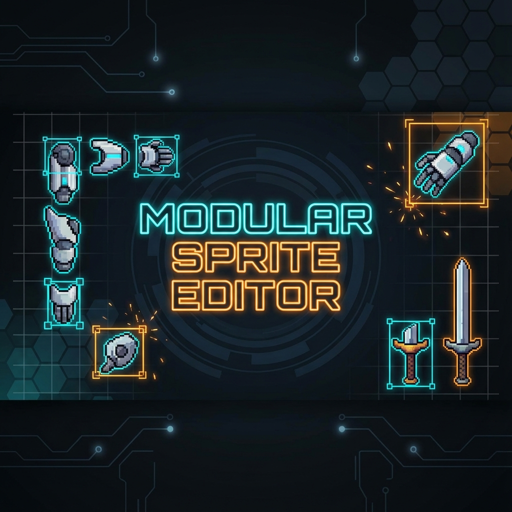

# Modular Sprite Editor

**A specialized tool for assembling, animating, and mapping modular pixel-art sprites for retro consoles.**

Construct complex character animations from individual body parts (modules). Define pivots, assemble frames, create animations, and map internal hitboxes/points for game logic — then export to SGDK (Mega Drive) or RetroAnimator.

  

---

## ⚠️ Project Status

- The **Modules / Frames / Animations / Mappings** workflow is actively used and is the most complete part of the tool.
- The **Timeline Editor is experimental** and still in active development. Behavior, data shape, and UX are not final yet.
- SGDK export and demo content lives in [`examples/sgdk`](examples/sgdk/README.md), including a blob-based runtime data path for Mega Drive tests.
- Project files carry a `format_version` (currently 2); older files are upgraded on load. See [`docs/FILE_FORMAT.md`](docs/FILE_FORMAT.md).

---

## ✨ Key Features

### Everywhere
*   **Project-wide Undo/Redo** for every editor, unsaved-change tracking and a save prompt on close.
*   **One canvas model**: wheel/pinch zooms in integer pixel steps, Space/Alt/middle-drag pans, `Ctrl+0` fits.
*   **Preview mapping selector** above the tabs — the mapping applied to every preview and to exports.
*   **Filters** on all long lists (modules, frames, animations, palettes).

### 🛠️ Module Editor
*   **Sprite Sheet Slicing**: Import sheets and define modules by drawing, numerically (X/Y/W/H), by grid slice, auto detect or auto modularize (console tile profiles).
*   **Pivot Definition**: Shift+drag or type the pivot of every module.
*   **Vector shape modules** (rects, arcs, triangles, lines, markers) rendered pixel-exact.

### 🖼️ Frame Editor
*   **Visual Assembly**: Drag modules (or other frames) onto the canvas to build keyframes.
*   **Pixel-exact editing**: arrow-key nudging (Shift = 8 px tile), flip (H/V), 90° rotation (R), draw order, copy/paste/duplicate of parts between frames.
*   **Collision & Points**: Hitboxes and utility points with semantic roles, compiled into per-animation lookup tables.
*   **Onion Skinning**: ghost the previous/next frame of the list.

### 🎬 Animation Editor
*   **Frame strip** with hold durations (ticks), drag & drop, reordering.
*   **Playback**: Loop, Ping-Pong, Forward, Backward, loop counts and FPS (ticks per second).
*   **Onion Skinning**, trajectory view, offset dragging/nudging and mirror preview.
*   **GIF Export**.

### 🧪 Timeline Editor (Experimental)
*   **Scene Composition** from modules, frames and animations, with parenting and draw order.
*   **Keyframes** with easing, linear/spline motion paths, per-key source switches and root motion.

### 🎯 Mapping Editor
*   **Module Variants**: Replace modules (e.g. "Clean Armor" → "Damaged Armor") or hide them (invisibility) without touching frames.

---

## 🚀 Getting Started

### Prerequisites
*   Python 3.10 or higher
*   pip (Python Package Manager)

### Installation (Development)

1.  **Clone the repository**
    ```bash
    git clone https://github.com/leissler/modular-sprite-editor.git
    cd modular-sprite-editor
    ```

2.  **Create a Virtual Environment**
    ```bash
    # Mac/Linux
    python3 -m venv .venv
    source .venv/bin/activate

    # Windows
    python -m venv .venv
    .venv\Scripts\activate
    ```

3.  **Install Dependencies**
    ```bash
    pip install -r requirements.txt
    ```

4.  **Run the App** (optionally with a project to open)
    ```bash
    python app.py examples/sgdk/PoP_WW.json
    ```

### Build Executables
```bash
# macOS
./build_macos.sh

# Linux
./build_linux.sh
```

```bat
REM Windows
build_windows.bat
```

### Tests & Tools
```bash
python3 -m pytest -q                          # unit tests
python3 tools/gui_smoke.py [project.json]     # drives the real UI against a project (needs a display)
python3 tools/migrate_projects.py --dry-run DIR   # upgrade project files to the current format
```

---

## ⌨️ Controls

`Cmd` on macOS, `Ctrl` elsewhere. The full table is in **Help ▸ Keyboard & Mouse Shortcuts** (`Cmd+/`).

| Context | Action | Shortcut |
| :--- | :--- | :--- |
| **General** | New / Open / Save / Save As | `Cmd+N` / `Cmd+O` / `Cmd+S` / `Cmd+Shift+S` |
| | Undo / Redo (all editors) | `Cmd+Z` / `Cmd+Shift+Z` |
| | Switch tab | `Cmd+1` … `Cmd+5` |
| **Canvas** | Zoom at cursor | `Mouse Wheel` / trackpad pinch |
| | Pan | `Space + Drag`, `Alt + Drag`, `Middle Mouse Drag`, `Shift+Wheel` |
| | Fit / Actual pixels / Grid | `Cmd+0` / `Cmd+Shift+0` / `Cmd+G` |
| **Modules** | Move pivot | `Shift + Drag` |
| **Frames** | Nudge 1 px / 8 px | `Arrows` / `Shift+Arrows` |
| | Flip / Rotate 90° | `H` `V` / `R` (`Shift+R` = CCW) |
| | Draw order | `Cmd+↑/↓` (`Shift` = to front/back) |
| | Copy / Paste / Duplicate / Select all | `Cmd+C` / `Cmd+V` / `Cmd+D` / `Cmd+A` |
| **Animations / Timeline** | Play/Pause | `Enter` |
| | Previous/Next Frame | `,` / `.` (`←` / `→` in the frame strip) |

---

## 📚 Documentation

*   [`AGENTS.md`](AGENTS.md) — architecture, conventions and workflows for contributors and coding agents
*   [`docs/FILE_FORMAT.md`](docs/FILE_FORMAT.md) — project JSON schema and versioning
*   [`docs/UX_AUDIT.md`](docs/UX_AUDIT.md) — UI/UX audit, what changed, open items
*   [`docs/ANIMATION.md`](docs/ANIMATION.md) — animation capabilities and roadmap
*   [`examples/sgdk/README.md`](examples/sgdk/README.md) — SGDK export and Mega Drive runtime

---

## 📄 License

This project is licensed under the MIT License - see the LICENSE file for details.
