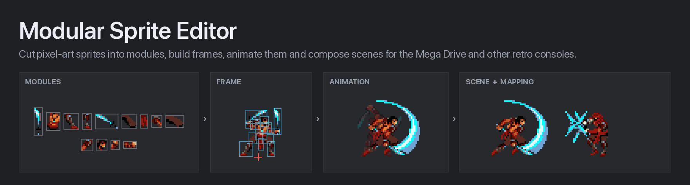

# Modular Sprite Editor

A desktop editor for modular pixel-art sprites on retro consoles, with the Mega Drive (SGDK) as the main target.

Artwork is cut into reusable **modules**, assembled into **frames** (positioned, flipped and rotated parts, nested
frames, hitboxes and points), sequenced into **animations**, composed in **timeline scenes** and re-skinned with
**mappings**. The SGDK exporter bakes it all into one blob that a small C runtime draws on the console exactly as the
editor shows it.

**Website and user guide: [modularsprites.bionic-productions.com](https://modularsprites.bionic-productions.com/)**

  

## Download

The editor and the SGDK exporter (`export_sgdk`) for Windows, macOS and Linux are on the
[Releases](https://github.com/leissler/modular-sprite-editor/releases) page, with the example projects in
`ModularSpriteEditor-examples.zip`. The builds are not signed: on Windows choose "More info › Run anyway", on macOS
right-click › Open the first time.

## Status

- **Modules, Frames, Animations and Mappings** are the most complete and most used part of the tool.
- **Timeline** (scenes) is newer: objects can carry their own mapping and animations can be choreographed with keys;
  the UX may still change.
- Project files carry a `format_version` (currently 4); older files are upgraded when opened. See
  [`docs/FILE_FORMAT.md`](docs/FILE_FORMAT.md).
- The SGDK exporter, the Mega Drive runtime and a demo ROM live in [`examples/sgdk`](examples/sgdk/README.md).

## Features

### Everywhere
- **Project-wide undo/redo** for every editor, unsaved-change tracking and a save prompt on close.
- **Welcome screen** with recent projects, the example projects and the user guide; **Help ▸ User Guide** (`F1`) and
  **Help ▸ Example Projects**. Empty tabs say what to make first.
- **Laptop-friendly**: view bars wrap instead of cutting controls off, inspector sections fold away (and stay folded),
  the window opens where and as large as it was. One selection rule: `Shift`+click adds, `Cmd`+click adds or removes.
- **Safe saving**: a save replaces the file in one step and keeps the previous version as `name.json.bak`; unsaved
  changes are autosaved every 30 s to a recovery folder and offered again after a crash.
- **Images edited elsewhere reload by themselves** when you return to the editor.
- **Check Project** (Tools menu): everything an export would leave out or show differently, such as steps whose
  frame was deleted, missing images, more colours than the console has or names that clash in C, with Go to and a
  fix for most. Deleting something that is still used asks whether to remove its uses too.
- **One canvas model**: wheel/trackpad zoom glides and settles on whole pixel sizes (1×, 2×, 3×…), Space/Alt/middle-drag
  pans, `Cmd/Ctrl+0` fits.
- **Preview mapping** above the tabs: the mapping every preview and export uses.
- **Filters** on all long lists (modules, frames, animations, palettes).

### Modules
- **Cut directly on the sheet**: drag over a sprite to make a module; move, resize (8 handles, optional grid snap) and
  nudge it right there; Cmd+drag selects several.
- **Slicing tools**: grid slice (tile size, offset, gap, skip empty tiles) and sprite detection (touching pixels, merge
  gap; milliseconds on a full sheet). Both can keep the existing modules and add only new areas. Copy modules and paste
  them onto another image to cut the same areas there.
- **From sheet to animation in one step**: select a row of whole sprites and choose **New animation** (a frame for
  each, an animation through them), or let grid slice make a frame for every tile and an animation for every row.
- **Auto Modularize** (Slice ▾ or Tools): cuts an image's whole sprites into hardware-sized parts they share, found at
  any offset and also mirrored, on a new image, and rebuilds the frames from them pixel for pixel. A preview shows every
  sprite's cut and the Mega Drive cost before and after (VRAM tiles, hardware sprites); one slider trades fewer tiles
  against fewer hardware sprites. The Sonic example's 38 whole frames go from 869 to 655 tiles with fewer hardware
  sprites per frame than its hand-cut version.
- **Pivots**: Shift+drag, type them, or a 3×3 preset (bottom centre = feet on the origin); **Trim** shrinks modules to
  their pixels.
- **Images list** with thumbnails, missing files flagged (**Locate…** relinks), key colour picked from the image;
  **modules list** with thumbnails, size and how often each is used.
- **Palettes**: each image belongs to one of the Mega Drive's four palettes; the inspector shows the palette's colours
  as the console shows them and warns when its images use more than 15. **View ▸ Mega Drive Colours** shows every
  canvas in the console's colours (3 bits per channel, through the export's palettes).
- **Vector shape modules** (rects, arcs, triangles, lines, markers) on their own *Shapes* sheet, rendered pixel-exact.

### Frames
- **Frames list with thumbnails** and usage; a **library** of modules (per image) and frames to drag onto the stage or
  double-click.
- **Parts / Hitboxes / Points** modes above the stage; the inspector edits the selection (position, flips, rotation,
  draw order, swap the source; hitbox type, role, rect) and the frame (mirror, rotate, put the feet on the origin).
- **Contents list** of the frame's parts (top-most first; drag to reorder), hitboxes or points; marquee selection.
  A click places a point, a drag draws a hitbox.
- **Pixel-exact editing**: arrow-key nudging (Shift = 8 px tile), flip (H/V), 90° rotation (R), draw order,
  copy/paste/duplicate of parts between frames.
- **Hitboxes and points** with semantic roles (compiled into per-animation lookup tables); types managed inline.
- **Onion skin**: ghost the previous/next frame of the list.

### Animations
- **Sequence on a tick ruler**: every step is as wide as its hold; drag a step's right edge to change the hold, drag
  steps to reorder (Alt copies), drop frames from the library where they should go (several at once: Shift+click a run
  of frames; right-click makes them a new animation).
- **Playback like the game**: Loop, Play once, Ping-pong and Loop backwards follow the SGDK runtime tick by tick;
  preview speed ½× / ¼× / 2×.
- **Stage**: drag to move the selected steps' offsets, motion path, onion skin, mirror preview, part bounds, hitboxes
  and points.
- **Game data**: step **events** (hit windows, sounds, spawns, with a value), **Loop from** a step (an intro plays
  once) and **Then play** a follow-up animation (`attack → idle`). The runtime plays them exactly like the preview; the
  stage shows the current step's events and lights them up when they fire.
- **GIF export** of one playback cycle, pixel-identical to the editor.

### Timeline (scenes)
- **Library → stage**: drag animations, frames or modules onto the stage; a console screen guide (MD / SNES / NES /
  GBA / GB) shows what fits on screen, placed the way the SGDK demo shows scenes.
- **Layers and dopesheet** in one timeline, counted in frames: lower rows draw on top, drag a layer onto another to
  parent it, eye / lock per layer.
- **Auto-Key**: moving, flipping or rotating an object sets a key at the playhead; with Auto-Key off, edits move the
  whole layer.
- **Readable tweens**: bars between keys show the easing by name, curved paths are edited on the stage, animation frame
  changes show as ticks.
- **Choreography**: an animation swapped in at a key plays from that key, and root motion follows the object (a
  mirrored fighter steps forward to the left).
- **Animations play as animated**: an object plays its animation exactly like the Animations tab and the game (Play
  once ends, repeat counts, "loop from", the follow-up animation takes over); Loop, Play once, Ping-pong and Loop
  backwards override that. Flips and visibility change exactly at a key.
- **Mapping per object**: a guard drawn from the hero's animations, next to the hero. Objects inherit their parent's
  mapping (at the top level the preview mapping) or use one of their own, also in the SGDK export.

### Mappings
- **Module variants**: replace modules ("clean armour" → "damaged armour") or hide them without touching any frame.
- **Module map**: every module with what it shows under the mapping; select rows and click a replacement (or drag it
  onto a row); filter by image or "changed only".
- **Bulk matching**: map a whole sheet onto a recoloured copy with the same layout, or by names (`_red` → `_blue`).
- **Preview** of the frames the selected modules appear in, drawn with the mapping.

### Mega Drive / SGDK
- **Budget overlay** in the Frames, Animations and Timeline view bars (Mega Drive H40 / H32, and SNES with 8/16 or
  16/32 sprites): the hardware sprites each part becomes, scanlines where sprites would drop out, sprite counts and,
  for the Mega Drive, the video memory: tiles of what is shown, of the animation and of the whole project against the
  ~1424 SGDK leaves free. The numbers follow the exporter exactly.
- **Export from the editor** (File ▸ Export ▸ Mega Drive) or the command line (`export_sgdk`): tiles, palettes,
  frames, animations, scenes, hitboxes, points, events and every mapping in one binary blob, written into the game's
  SGDK project (its own resources stay). It reports what the game gets: the video memory the sprites need, merged
  colours and anything Check Project finds.
- **Runtime** (`examples/sgdk/sgdk_demo`): tiles stay in VRAM and drawing only writes the sprite table (on average 7 %
  of a frame for the Prince of Persia animations, measured in BlastEm). It draws modules, frames, animations and
  scenes; characters can share animations and differ by mapping (`ms_draw_anim_player_mapped`). Tests compile it for
  the host and compare what it draws with the editor pixel by pixel.
- **Demo ROM**: browse every module, frame, animation and scene with live profiling.

### Import and export
- Import AuroraGT `.sprite` files and RetroAnimator JSON; export RetroAnimator JSON (with the preview mapping baked
  in), SGDK data and animated GIFs.

## Examples

| Project | What it shows |
| :--- | :--- |
| [`examples/sgdk/PoP_WW.json`](examples/sgdk/PoP_WW.json) | Prince of Persia: 165 modules, 207 frames, 68 animations, 2 mappings and the *Swordfight* scene (the Prince against a guard drawn with the "Normal" mapping) |
| [`examples/sonic/sonic.json`](examples/sonic/sonic.json) | Sonic: 65 modules, 38 frames, 171 animations |
| [`examples/adventurer/adventurer.json`](examples/adventurer/adventurer.json) | A sheet of 15 whole sprites to try Auto Modularize on |

## Run from source

Python 3.10 or newer:

```bash
git clone https://github.com/leissler/modular-sprite-editor.git
cd modular-sprite-editor
python3 -m venv .venv
source .venv/bin/activate          # Windows: .venv\Scripts\activate
pip install -r requirements.txt
python3 app.py examples/sgdk/PoP_WW.json
```

## Build and release

```bash
./build_macos.sh      # macOS
./build_linux.sh      # Linux
build_windows.bat     # Windows
```

Releases come from the **Build And Release** workflow (Actions ▸ Run workflow, with a version). It builds the editor and
the SGDK exporter for all three platforms and tests every build: unit tests, the built editor drives every tab against
both example projects (`--smoke-test PROJECT.json [LOG]`), and the built exporter must write exactly what the Python one
writes. It publishes `ModularSpriteEditor-{macos,windows}.zip`, `ModularSpriteEditor-linux.tar.gz`, `export_sgdk-*` and
the example projects, `ModularSpriteEditor-examples.zip` (`tools/make_examples_zip.py`, `packaging/examples/`);
with *publish* off it only builds and tests. Set `APP_VERSION` in `app.py` to the version first: the About box shows it,
and the workflow stops if the two differ.

The run also leaves a **Windows kit** (artifact `windows-kit`, not released) to hand to a developer: the editor,
`export_sgdk.exe`, the example projects and the SGDK demo with the SGDK it builds with, plus `export_to_sgdk.bat` /
`build_sgdk_demo.bat` and a README (`tools/make_windows_kit.py`, `packaging/windows_kit/`). CI unpacks it and builds the
PoP_WW and Sonic ROMs with those scripts.

## Tests and tools

```bash
python3 -m pytest -q                               # unit tests (no display needed)
python3 tools/gui_smoke.py [project.json]          # drives the real UI against a project (needs a display)
python3 tools/check_export_parity.py PROJECT...    # RetroAnimator export vs. the editor canvas, pixel by pixel
python3 tools/migrate_projects.py --dry-run DIR    # upgrade project files to the current format
python3 tools/automod_bench.py PROJECT.json        # Auto Modularize benchmark: exactness, tiles, hardware sprites
python3 tools/make_readme_banner.py                # this README's banner, rendered from the PoP example
python3 tools/make_app_icon.py                     # the app icon (pixel art), every size, and the website logo
python3 tools/make_logo.py                         # the product logo: the icon's mannequin over a pixel wordmark
```

## Controls

`Cmd` on macOS, `Ctrl` elsewhere. The full table is in **Help ▸ Keyboard & Mouse Shortcuts** (`Cmd+/`).

| Context | Action | Shortcut |
| :--- | :--- | :--- |
| **General** | New / Open / Save / Save As | `Cmd+N` / `Cmd+O` / `Cmd+S` / `Cmd+Shift+S` |
| | Undo / Redo (all editors) | `Cmd+Z` / `Cmd+Shift+Z` |
| | Switch tab | `Cmd+1` … `Cmd+5` |
| **Canvas** | Zoom at cursor (settles on whole pixel sizes) | `Mouse Wheel` / two-finger scroll / pinch |
| | Pan | `Space + Drag`, `Alt + Drag`, `Middle Mouse Drag`, `Shift+Wheel` |
| | Fit / Actual pixels / Grid | `Cmd+0` / `Cmd+Shift+0` / `Cmd+G` |
| | Mega Drive colours | `Cmd+Shift+P` |
| **Modules** | New module / move / resize | Drag on the image / drag a module / drag a handle |
| | Move pivot / select several / add or remove one | `Shift + Drag` / `Cmd + Drag` / `Cmd + Click` |
| | Nudge 1 px / 8 px | `Arrows` / `Shift+Arrows` |
| **Frames** | Nudge 1 px / 8 px | `Arrows` / `Shift+Arrows` |
| | Flip / Rotate 90° | `H` `V` / `R` (`Shift+R` = CCW) |
| | Draw order | `Cmd+↑/↓` (`Shift` = to front/back) |
| | Copy / Paste / Duplicate / Select all | `Cmd+C` / `Cmd+V` / `Cmd+D` / `Cmd+A` |
| | Select several parts / add a part / add or remove one | Drag on empty space / `Shift + Click` / `Cmd + Click` |
| | New point (Points mode) | Click on empty space |
| **Mappings** | Original / hide the selected modules | `Delete` / `H` |
| **Animations / Timeline** | Play/Pause | `Enter` |
| | Previous/Next step (Animations) or frame (Timeline) | `,` / `.` (`←` / `→` in the sequence / timeline) |
| **Animations** | Previous/Next tick, first/last step | `Shift+,` / `Shift+.`, `Home` / `End` |
| | Shorter / longer hold | `[` / `]` or drag a step's right edge |
| | Flip / Rotate selected steps | `H` `V` / `R` (`Shift+R` = CCW) |
| **Timeline** | Previous/Next key, first/last frame | `Shift+,` / `Shift+.`, `Home` / `End` |
| | Set key / add-or-remove key at playhead | `K` / `Shift+K` |
| | Flip / Rotate selected object | `H` `V` / `R` (`Shift+R` = CCW) |

## Documentation

- [The user guide](https://modularsprites.bionic-productions.com/) for artists and animators (source in [`website/`](website/README.md))
- [`AGENTS.md`](AGENTS.md): architecture, conventions and workflows for contributors and coding agents
- [`docs/FILE_FORMAT.md`](docs/FILE_FORMAT.md): project JSON schema and versioning
- [`docs/UX_AUDIT.md`](docs/UX_AUDIT.md): UI/UX audit, what changed, open items
- [`docs/ANIMATION.md`](docs/ANIMATION.md): animation capabilities and roadmap
- [`examples/sgdk/README.md`](examples/sgdk/README.md): SGDK export and the Mega Drive runtime

## License

MIT; see [LICENSE](LICENSE). The example sprite art (Prince of Persia, Sonic, Adventurer) belongs to its respective
owners, is not covered by this license and is included only to test the editor. The Adventurer sheet is
[Pixel Art Adventurer Sprites](https://elthen.itch.io/pixel-art-adventurer-sprites) v1.1 by Elthen, under
[CC BY-NC 4.0](https://creativecommons.org/licenses/by-nc/4.0/) with the
[artist's additional permissions](https://www.patreon.com/posts/27430241); see
[examples/adventurer/CREDITS.md](examples/adventurer/CREDITS.md).
