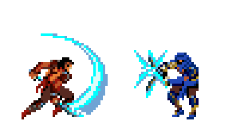
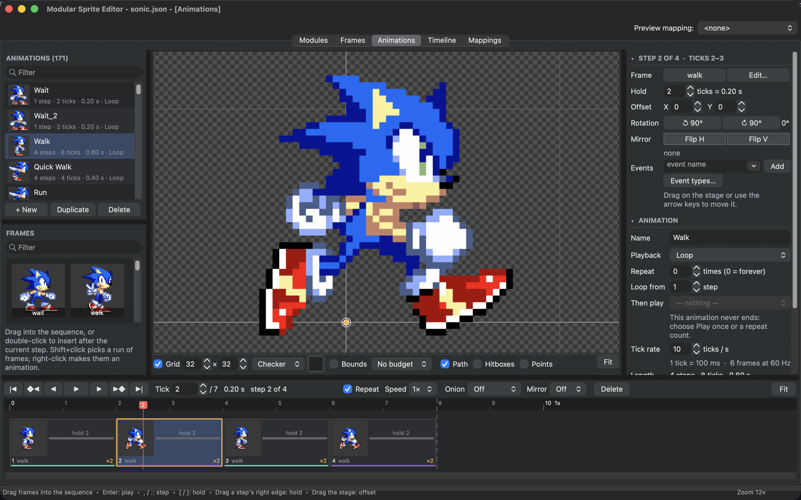
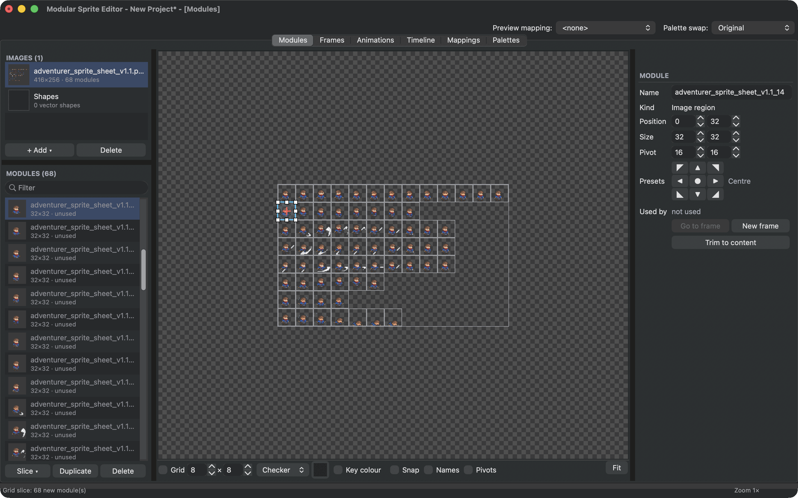

# The example projects

Three example projects come with the editor's source code. Download **Source code (zip)** from the [latest release](https://github.com/leissler/modular-sprite-editor/releases/latest), unpack it and open a project with **File ▸ Open...**. Keep each project next to its image.

The sprite art in the examples belongs to its owners and is included only to show and test the editor. See [Credits](../reference/credits.md).

## Prince of Persia

`examples/sgdk/PoP_WW.json` is the most complete example: the Prince from a mobile Prince of Persia game, cut into 165 small parts on one sheet, with 207 poses, 68 animations, two mappings and a scene.

{ .ms-pixel width="408" height="216" }

Things to look at:

- **Modules**: the parts are tiny, often just a forearm or a boot, and **Used by** shows that many are used in more than 50 frames.
- **Frames**: turn on **Part bounds** to see how many parts a pose has, and **Budget** to see what it costs on the console.

- **Hitboxes and points**: choose **Hitboxes** or **Points** above the stage of the **Frames** tab. Every pose has hurt boxes for the head and the body, the striking poses an attack box, and points mark the feet and, in combat, the tip of the blade. See [Hitboxes and points](../guide/hitboxes-points.md).
- **Animations**: play **C34 Attack**, **C06 slash** or **A05 run**. Turn on **Path** to see how a jump moves. The attacks have a `hit` event on the step where the blade strikes, the runs a `footstep` when a foot lands.
- **Mappings**: **Normal** turns the Prince into a hooded guard. **Invizibil** swaps 89 body parts for an empty module, so only his swords remain visible. Try both with **Preview mapping** at the top of the window.
- **Timeline**: the **Swordfight** scene, explained in [Inside the Swordfight](swordfight.md).

## Sonic

`examples/sonic/sonic.json` is a hand-cut Sonic with 65 modules, 38 frames and 171 animations. Open the **Animations** tab and play through them: it is a good example of how many animations a small set of poses can drive, with holds, offsets and flips doing the rest.

<figure class="ms-shot" markdown="span">
  [{ width="1440" height="900" loading="lazy" }](../assets/images/screens/example-sonic.png)
  <figcaption>Sonic's walk in the <strong>Animations</strong> tab.</figcaption>
</figure>

The [Auto Modularize guide](../guide/auto-modularize.md) shows the same Sonic poses as whole sprites, cut into shared parts automatically.

## Adventurer

`examples/adventurer/adventurer.json` is a sheet of whole sprites in 32 by 32 pixel cells, sliced into 68 modules with 15 frames. It has no animations yet, which makes it a good sheet to practise on:

<figure class="ms-shot" markdown="span">
  [{ width="1440" height="900" loading="lazy" }](../assets/images/screens/lesson-sliced.png)
  <figcaption>The Adventurer sheet, cut into 32 by 32 pixel modules.</figcaption>
</figure>

- follow [Your first animated sprite](../start/first-sprite.md) to animate its run;
- run [Auto Modularize](../guide/auto-modularize.md) on it and compare the memory before and after.

The sheet is version 1.1 of [Pixel Art Adventurer Sprites](https://elthen.itch.io/pixel-art-adventurer-sprites) by Elthen, under CC BY-NC 4.0 (see [Credits](../reference/credits.md)). Elthen's page has the latest version, with many more animations.
