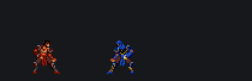

# Inside the Swordfight

The Swordfight is a short scene in the Prince of Persia example: the Prince and a hooded guard draw their swords, trade attacks and blocks, and the Prince wins with a finishing move. It uses only the Prince's animations. The guard is the Prince with the "Normal" mapping.

{ .ms-pixel width="420" height="136" }

Open `examples/sgdk/PoP_WW.json`, go to the **Timeline** tab and press ++enter++.

## How it is built

The scene runs at 10 frames a second for 110 frames, eleven seconds, and loops. The Prince's animations run at 10 ticks a second, so one animation step lasts one scene frame.

There are two layers, one per fighter:

- **Guard** is flipped to face left and has its **Mapping** set to **Normal**. It is the upper row, so it is drawn behind the Prince.
- **Prince** inherits the preview mapping, so you can try other looks on him.

Both play their animations in **Play once** mode with **Root motion** on: a step forward really moves the fighter, and because root motion follows the mirror, the guard steps forward to the left.

## One key per action

Every key on a fighter's track swaps in the next animation, labelled on the timeline. An animation swapped in at a key starts at that key, so each action begins exactly on its frame:

| Frame | Prince | Guard |
| --- | --- | --- |
| 0 | stands | stands |
| 8 | draws his swords | draws his swords |
| 12 | takes guard | takes guard |
| 18 | steps forward | |
| 22 | slashes | blocks, sparks fly |
| 32 | | steps forward |
| 36 | | winds up a big attack |
| 43 | blocks the swing | |
| 52 | dashes in and strikes | |
| 56 | | is hit and staggers |
| 63 | grabs, stabs and throws | is grabbed and thrown |
| 88 | | lies still |
| 94 | puts his swords away | |

The finishing move is a pair of animations made to fit together: **C20 multi stab throw** for the Prince and **C21 multi stab throw enemy** for the guard, started on the same frame.

## Where the fighters stand

Root motion moves a fighter only while its animation plays. When the next animation starts, the fighter would jump back to where its key put it. So each key also moves the fighter to where the previous animation left him, and the motion between keys is set to **Hold**: the fighter stays put during an animation and the key takes over at its frame.

Select a key and look at **Position** in the inspector to see it. After the Prince's step forward, his next key is 10 pixels further right.

## Try something

- Set the guard's **Mapping** to **Original modules**: two Princes fight.
- Set **Preview mapping** at the top to **Invizibil**: the Prince becomes invisible except for his swords, while the guard keeps his own mapping.
- Drag the guard's attack key at frame 36 a few frames later and play it. The Prince now blocks too early.
- Turn on **Budget** at frame 70, during the finishing move, to see what both fighters together cost on a Mega Drive.

The same scene plays on a real Mega Drive with the editor's SGDK runtime, drawn from the same project. See [For your programmer](../reference/programmers.md).
