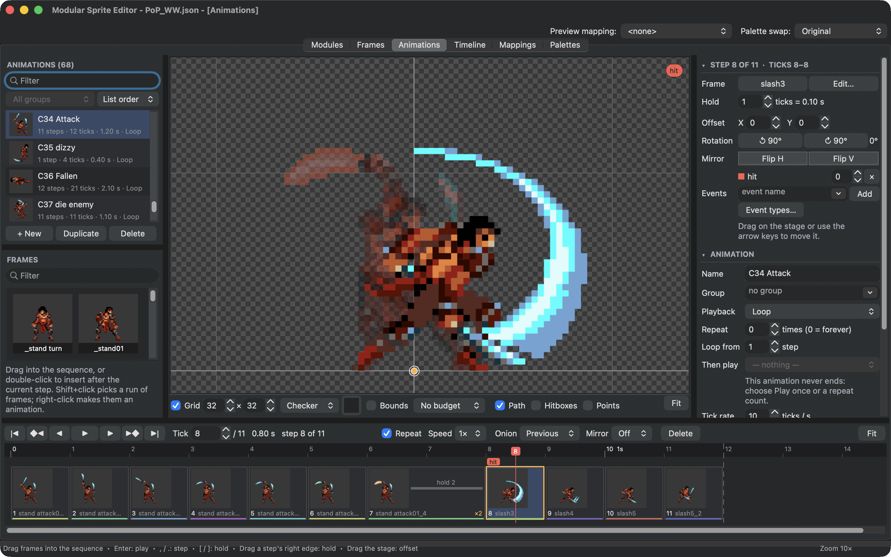
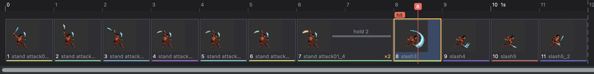
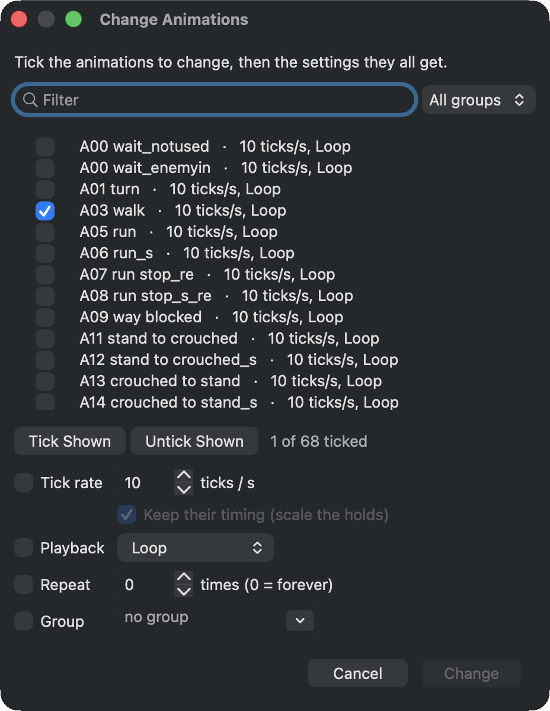
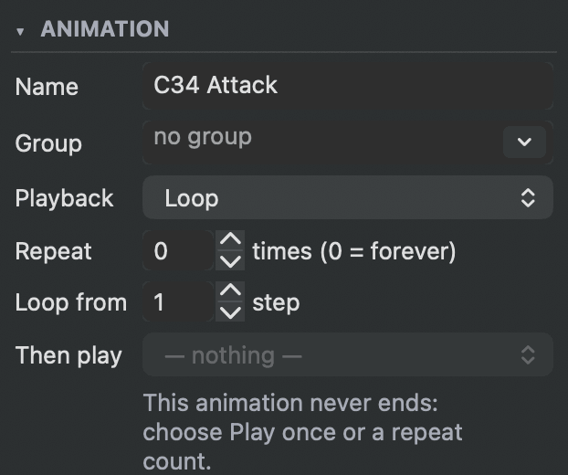
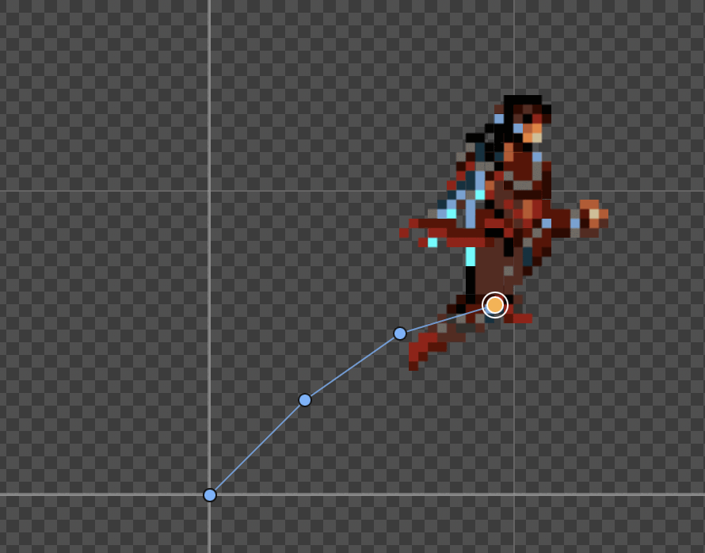
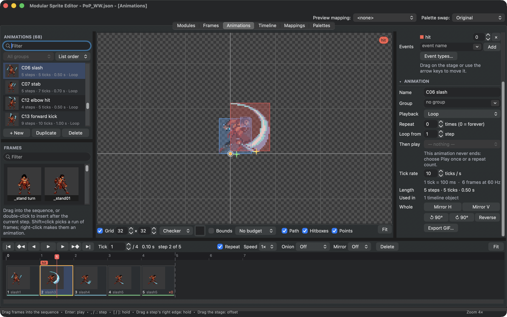
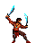

# Animate

An animation is a row of steps. Each step shows a frame for a number of ticks, and can move, flip or turn it. The **Animations** tab plays them exactly as the game will, so what you time here is what players see.

<figure class="ms-shot" markdown="span">
  
  <figcaption>The Prince's attack at its eighth step. The step before is shown as onion skin; the wide step 7 holds for two ticks.</figcaption>
</figure>

## Make an animation

Choose **+ New** under the animation list. Each row shows how many steps and ticks the animation has, how long it lasts and how it plays. A long list can be put into groups and sorted, see [Lists](../start/tour.md#lists).

Add steps from the **Frames** palette below the list: drag a frame into the sequence at the bottom, exactly where it should go, or double-click it to add it after the current step. You can also drop frames on the stage. ++shift++-click picks a run of frames and ++cmd++-click single ones; drag them in together, or right-click them for **New Animation from Frames**, which makes an animation of them in one go.

In the sequence:

- click a step to select it, ++shift++-click to select a range and ++cmd++-click to add or remove single steps;
- drag a step to move it, hold ++alt++ to copy it instead;
- ++delete++ removes the selected steps;
- double-click a step to open its frame in the **Frames** tab.

<figure class="ms-shot" markdown="span">
  [{ width="1174" height="149" loading="lazy" }](../assets/images/screens/anim-sequence.png)
  <figcaption>The sequence of <strong>C34 Attack</strong>. Each step is as wide as its hold, stripes mark steps that show the same frame, and step 8 carries a <code>hit</code> event.</figcaption>
</figure>

Right-click a step for more: **Swap frame...** shows another frame in the same step, **Reverse order** reverses the selected steps, and the menu also flips, turns, copies and pastes steps.

## Timing

Time is counted in **ticks**. **Tick rate** in the inspector sets how many ticks make a second, and the line below it says what one tick is in milliseconds and in frames of a 60 Hz screen. Ten or twelve ticks a second is a good start for pixel-art animation. New animations start with the tick rate set in **Preferences**.

The console shows a new picture 60 times a second, so in the game every step lasts a whole number of these video frames. With 10, 12, 15, 20 or 30 ticks a second each tick is exactly that; with other rates the game rounds each step to whole frames, the preview plays it the same way and the inspector says so (**Tools ▸ Check Project** notes it too). **View ▸ Play at 50 Hz** plays every preview as a PAL console shows the game: 50 video frames a second, so everything runs at five sixths of the speed.

Each step **holds** for a whole number of ticks. In the sequence, a step is as wide as its hold, so you can see the rhythm at a glance. Change a hold by dragging the right edge of a step, with ++bracket-left++ and ++bracket-right++, or in **Hold** in the inspector. Several selected steps change together.

When the same frame appears more than once, a coloured stripe under its steps shows it, which helps when you build a loop from a few poses.

**Spread** gives several selected steps a rhythm in one go: **1-1-2-2** and **1-2** repeat a pattern, **Slow start** and **Slow end** hold the first or the last steps longer, the way a motion leaves or reaches a pose. The patterns count in the shortest hold of the selected steps. Find **Spread** under **Hold** in the inspector, or in the step menu's **Hold**.

**Tools ▸ Change Animations...** (also in the animation list's right-click menu) gives many animations one setting at once: tick the animations, then the **Tick rate** (**Keep their timing** scales the holds so every step lasts as long as before), the **Playback**, the **Repeat** count or the **Group** they all get. It is one undo step.

<figure class="ms-shot" markdown="span">
  [{ width="464" height="600" loading="lazy" }](../assets/images/screens/change-animations.png)
  <figcaption>One tick rate, playback, repeat count or group for many animations.</figcaption>
</figure>

## Play it like the game

Press ++enter++ to play and stop. ++comma++ and ++period++ step one pose back or forward, ++shift+comma++ and ++shift+period++ one tick, ++home++ and ++end++ jump to the first and last step. **Speed** plays at half, a quarter or double speed, and **Repeat** in the transport keeps a finished animation playing in the preview.

**Playback** in the inspector decides how the animation plays in the game, and the preview follows it exactly:

- **Loop** plays the steps over and over.
- **Play once** plays them once and stops on the last step.
- **Ping-pong** plays forward, then backward, then forward again, without repeating the end steps.
- **Loop backwards** plays the steps from last to first, over and over.

**Repeat** sets how many times a repeating animation plays before it ends, 0 for forever. **Loop from** makes later passes of a loop start at a later step, so an intro, such as drawing a sword, plays only once. **Then play** names an animation that starts when this one ends, such as an attack that returns to the idle pose. The inspector warns when an animation can never end, because then it never reaches what follows.

<figure class="ms-shot ms-shot--part" markdown="span">
  [{ width="311" height="260" loading="lazy" }](../assets/images/screens/anim-settings.png)
  <figcaption>An attack that loops forever: the inspector warns that it never reaches what <strong>Then play</strong> names.</figcaption>
</figure>

## Moving, flipping and turning steps

Select a step and its settings appear under **Step**, at the top of the inspector while steps are selected.

**Offset** moves the frame in this step. Drag on the stage or use the arrow keys. Offsets are how a character moves forward while it runs or jumps: turn on **Path** in the view bar to see the motion of every step as a line.

<figure class="ms-shot ms-shot--part" markdown="span">
  [{ width="445" height="349" loading="lazy" }](../assets/images/screens/anim-path.png)
  <figcaption><strong>Path</strong> on: the steps of a standing jump move up and forward.</figcaption>
</figure>

**Rotation** turns the step's frame in 90 degree steps, and **Mirror** flips it. The **Mirror** preview in the transport shows the whole animation flipped, to check how it looks when the character faces the other way. The preview only changes the view.

**Whole** applies to every step at once: mirror, turn, **Reverse**.

## Onion skin

**Onion** in the transport shows the previous step, the next step or both as faint ghosts: the previous in red, the next in blue. Use it to keep spacing even and to find jumps between poses.

## Events

A step can tell the game that something happens: a footstep sound, the moment a sword hit counts, where a projectile appears. Select steps, then under **Events** in the inspector pick an event or type a new name, and choose **Add**. A new name joins the project's list of events. Each event on a step can have a value, such as which sound to play.

**Event types...** manages the list of event names and their colours for the whole project. On the stage, the current step's events show as small labels and light up when their step starts during playback, the moment the game receives them.

<figure class="ms-shot" markdown="span">
  [{ width="1440" height="900" loading="lazy" }](../assets/images/screens/anim-events.png)
  <figcaption>The second step of <strong>C06 slash</strong> carries a <code>hit</code> event: a label on the stage, a marker in the sequence and a row under <strong>Events</strong>.</figcaption>
</figure>

## Export a GIF

**Export GIF...** writes one cycle of the animation as an animated GIF, with the preview mapping and palette swap applied. It looks exactly like the editor's preview. **File ▸ Export** also writes the animation as a PNG sequence and every animation as a sprite sheet for other engines, see [Work with other tools](other-tools.md).

{ .ms-pixel width="204" height="192" loading="lazy" }

