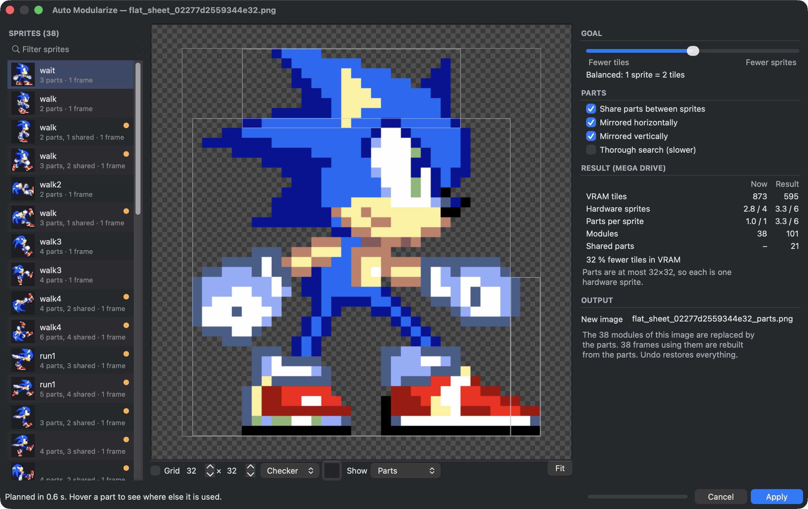
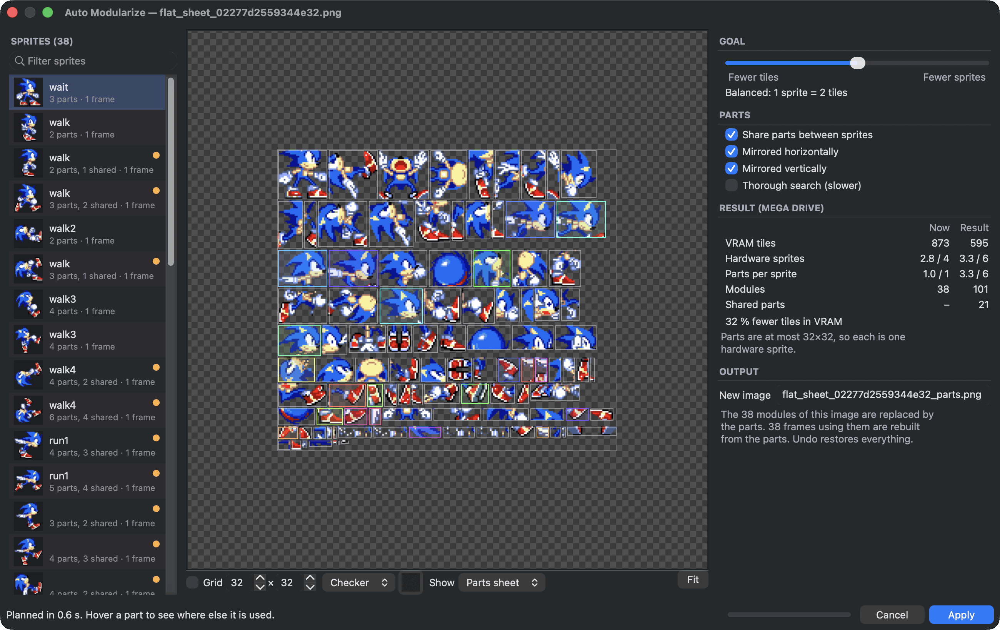

# Find shared parts automatically

Many sprite sheets are drawn as whole poses: every frame a complete picture. That is a natural way to draw, but it repeats the same head, hands and boots in every pose, and each repeat costs memory on the console.

**Auto Modularize** looks for the pieces your sprites have in common, also mirrored ones, puts each piece on a new image once and rebuilds every frame from them. The result looks exactly the same, pixel for pixel, and uses less memory.

<figure class="ms-shot" markdown="span">
  [{ width="1300" height="820" loading="lazy" }](../assets/images/screens/automod.png)
  <figcaption>Auto Modularize on a sheet of 38 whole Sonic sprites: 873 video memory tiles become 595, 32 % fewer, with every frame unchanged.</figcaption>
</figure>

## Before you start

Auto Modularize works on one image whose modules are whole sprites. If your sheet is not cut yet, use **Grid slice...** or **Detect sprites...** first (see [Cut a sheet into modules](modules.md)). Then make a frame for every sprite: select the modules and choose **New frames** in the inspector, or use **Tools ▸ Create Reference Frames From All Image Modules...**. The frames are what Auto Modularize rebuilds from the parts: when you apply it, the whole-sprite modules are replaced.

## Open it

Select the image in the **Modules** tab and choose **Slice ▾ ▸ Auto modularize...**. **Tools ▸ Auto Modularize Image...** does the same.

The window starts planning right away. The status line shows how long it took. Every change of a setting plans again in the background, usually in about a second.

## Read the result

The **Sprites** list on the left shows every sprite with how many parts it got and how many of them are shared with other sprites. A dot marks sprites with shared parts.

The canvas shows the selected sprite. **Show** chooses what you see:

- **Parts**: the sprite cut into its parts. Shared parts are coloured. Hover a part to see where else it is used.
- **Original**: the sprite as it is now.
- **Parts sheet**: the new image with every part once.

<figure class="ms-shot" markdown="span">
  [{ width="1300" height="820" loading="lazy" }](../assets/images/screens/automod-sheet.png)
  <figcaption><strong>Parts sheet</strong>: every part once, on the new image.</figcaption>
</figure>

**Result (Mega Drive)** compares now and after: video memory tiles, hardware sprites per sprite, parts per sprite, modules and shared parts.

## Choose what matters

The **Goal** slider trades **Fewer tiles** against **Fewer sprites**. Tiles are video memory, a limited resource for all graphics on screen. Hardware sprites are limited per screen and per line, see [Stay within the console's limits](hardware-budget.md). Many small shared parts save memory but need more sprites. A few bigger parts need fewer sprites but share less.

Under **Parts**:

- **Share parts between sprites** finds pieces that appear in several sprites. Turn it off to only cut each sprite into hardware-sized parts.
- **Mirrored horizontally** and **Mirrored vertically** also reuse a part that appears flipped.
- **Thorough search** looks for more, smaller shared pieces. It is slower.

## Apply

**Output** names the new image for the parts. Choose **Apply**. The parts go on the new image next to the old one, the old modules are replaced by the parts, and every frame that used them is rebuilt from the parts.

Apply is one step in the undo history. If you do not like the result, ++cmd+z++ brings everything back as it was.

!!! note "Exact by design"
    A part is only placed where every one of its pixels matches the sprite, and every visible pixel of every sprite is covered. Your frames look exactly as before.
