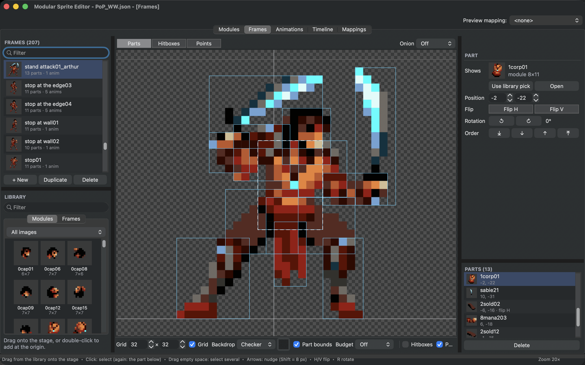
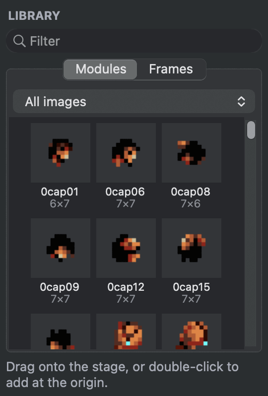
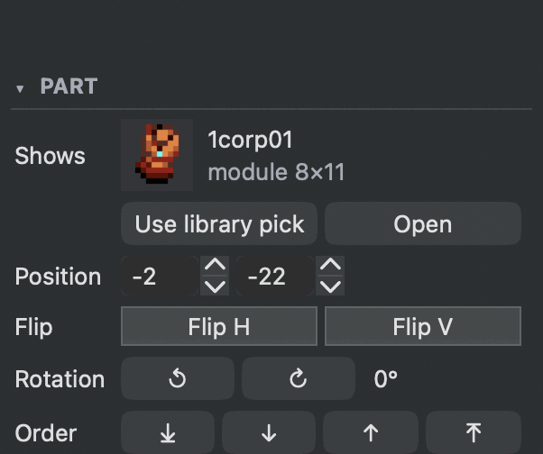
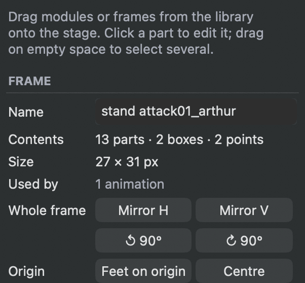
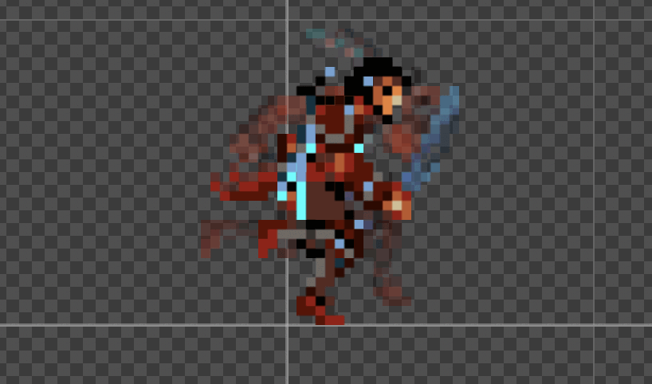

# Build frames from parts

A frame is a pose made from modules. You place each part, flip or turn it, and decide which part is in front. Because frames use modules rather than copies of pixels, changing a module changes every pose that uses it.

<figure class="ms-shot" markdown="span">
  
  <figcaption>A pose of the Prince built from 13 parts. <strong>Bounds</strong> outlines every part; the selected part shows its position, flip, rotation and draw order.</figcaption>
</figure>

## Make a frame

Choose **+ New** under the **Frames** list. **Duplicate** copies the selected frame, which is often the quickest start for the next pose.

The stage shows the frame's **origin** as two thin lines. The origin is the point the game positions, usually between the character's feet.

## Add parts

The **Library** below the frames list shows your modules, one image at a time or all of them, and your frames. Drag a module onto the stage, or double-click it to add it at the origin. The module's pivot lands where you drop it.

<figure class="ms-shot ms-shot--part" markdown="span">
  [{ width="270" height="399" loading="lazy" }](../assets/images/screens/frames-library.png)
  <figcaption>The <strong>Library</strong>, here with the modules of every image.</figcaption>
</figure>

## Select and arrange

Make sure **Parts** is selected above the stage.

- Click a part to select it. Click the same spot again to select the part below it.
- ++shift++-click adds parts to the selection and ++cmd++-click adds or removes one. Drag on empty space to select every part in a box. ++esc++ clears the selection.
- Drag to move. Arrow keys nudge by one pixel, ++shift++ by 8.
- ++h++ and ++v++ flip the selected parts, ++r++ turns them 90 degrees clockwise and ++shift+r++ counter-clockwise.
- ++cmd+arrow-up++ and ++cmd+arrow-down++ move a part in front of or behind its neighbour. Add ++shift++ to send it all the way to the front or back.

A flipped part stays where it is and mirrors its picture. Turns are about the part's pivot, in steps of 90 degrees, so pixels stay square.

The inspector shows the selected part: **Shows** names the module, **Position** is where its pivot sits, **Flip**, **Rotation** and **Order** do the same as the keys. To swap a part for another module, pick the new module in the library and choose **Use library pick**. **Open** shows the module in the **Modules** tab.

<figure class="ms-shot ms-shot--part" markdown="span">
  [{ width="301" height="252" loading="lazy" }](../assets/images/screens/frames-part.png)
  <figcaption>A selected part in the inspector.</figcaption>
</figure>

The **Parts** list at the bottom right lists every part of the frame, the front-most first. Drag rows to change the order.

## Copy parts between frames

Select parts, copy them with ++cmd+c++, select another frame and paste with ++cmd+v++. They keep their positions. ++cmd+d++ duplicates the selected parts in place. ++cmd+a++ selects every part.

## Use frames inside frames

Drag a frame from the library onto the stage to use it as one part. A nested frame keeps its parts together: build a head with its hair and helmet once, and place it as a single piece in every pose. Flip or turn it like any part. Changes to the nested frame show everywhere it is used.

**Tools ▸ Optimize Nested Frame Combos (All Frames)...** does this for you: it looks for groups of three or four parts that sit together the same way in several frames, makes each group a frame of its own (its name starts with *Combo*) and uses it in their place. The frames look the same as before. Undo takes it back.

## Work on the whole frame

With nothing selected, the inspector shows the frame. **Whole frame** mirrors or turns every part at once. **Origin** has two helpers: **Feet on origin** moves all parts so the middle of the pose's bottom edge sits on the origin, and **Centre** puts the middle of the pose there.

<figure class="ms-shot ms-shot--part" markdown="span">
  [{ width="301" height="280" loading="lazy" }](../assets/images/screens/frames-whole.png)
  <figcaption>With nothing selected, the inspector shows the frame.</figcaption>
</figure>

Right-click a frame in the list for the same tools, and for **Rename**, **Duplicate** and **Delete**. When animations, other frames or scenes still use a frame you delete, the editor asks whether to remove those uses too or to keep them as missing.

## Compare with neighbouring poses

**Onion** above the stage shows the previous, the next or both neighbouring frames of the list as faint ghosts behind the current one. Use it to keep a pose in line with the ones around it.

<figure class="ms-shot ms-shot--part" markdown="span">
  [{ width="409" height="241" loading="lazy" }](../assets/images/screens/frames-onion.png)
  <figcaption>A running pose with both neighbouring frames as ghosts.</figcaption>
</figure>

## Next

Frames can also carry [hitboxes and points](hitboxes-points.md) for the game. When you have a few poses, [animate them](animations.md).
