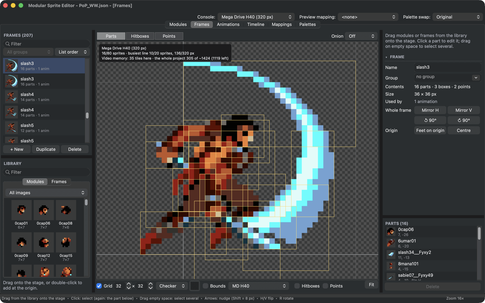
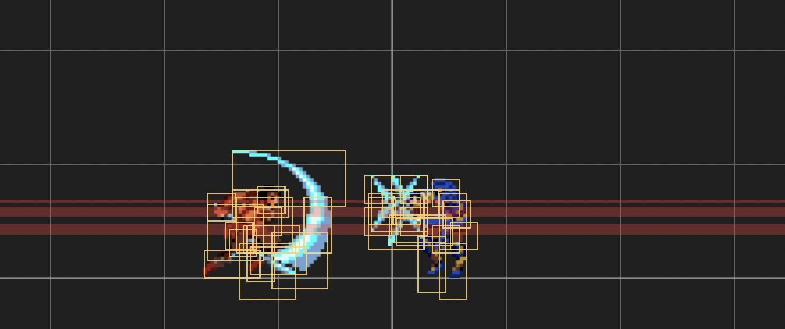
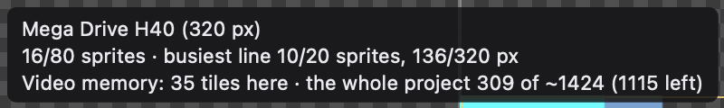
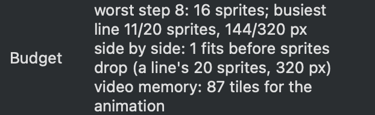

# Stay within the console's limits

A retro console does not draw your character as one picture. It shows it as **hardware sprites**: small rectangles made from 8 by 8 pixel **tiles** stored in video memory. There are limits on how many fit on the screen and on one line, and when a pose asks for too much, parts of it flicker or disappear. The budget overlay shows you this while you draw.

The editor knows the limits of the Sega Mega Drive, the Super Nintendo (SNES), the NES, the Game Boy Advance (GBA) and the Game Boy, each with its own entries in **Budget**.

<figure class="ms-shot" markdown="span">
  
  <figcaption>The slash pose needs 16 hardware sprites and 35 tiles of video memory. Its busiest line uses 10 of the 20 sprites a line can show.</figcaption>
</figure>

## Turn it on

In the view bar of the **Frames**, **Animations** or **Timeline** tab, change **No budget** to the first entry: the console your project is made for, as **Console** above the tabs sets it. It follows when you change the console. The entries marked **Compare:** show what the same art would cost on another console:

- **MD H40** is the Mega Drive's wide mode, 320 pixels across, used by most games.
- **MD H32** is the narrower mode, 256 pixels across.
- **SNES 8/16** to **SNES 32/64** are the Super Nintendo. Its sprites are squares in two sizes, and a game picks one pair for all of them: 8 and 16 pixels, 8 and 32, 8 and 64, 16 and 32, 16 and 64, or 32 and 64.
- **NES 8×8** and **NES 8×16** are the NES. All its sprites have one size, which the game picks: 8 by 8 pixels, or 8 by 16.
- **GBA** is the Game Boy Advance. Its sprites come in twelve shapes from 8 by 8 to 64 by 64 pixels: squares, and rectangles twice or four times as wide as high or the other way round.
- **GB 8×8** and **GB 8×16** are the Game Boy, with one sprite size per game like the NES.

On the Mega Drive, a hardware sprite is 8 to 32 pixels wide and high, in steps of 8. The editor covers each part with as few of them as it can and, with that, as few tiles: a sprite can start at any pixel, so the empty space around a sprite's pixels costs no tiles. On the SNES, the editor covers each part with the large squares, and uses small ones where the part's pixels only fill an edge or a corner of a large square. On the NES and the Game Boy, every 8 by 8 (or 8 by 16) piece of a part that holds a pixel is a sprite of its own. On the GBA, the editor covers each part with the shapes that cost least, weighing a sprite as much as 8 tiles: a 24 by 24 part becomes one 32 by 32 sprite, a 40 by 8 strip a 32 by 8 and an 8 by 8 sprite.

The editor remembers the choice for each tab: your project's console, whichever it is, or the one you compare with.

## Read it

Every hardware sprite the pose needs is outlined. A part bigger than the largest hardware sprite is split into several. Lines where too many sprites meet are marked in red: on the console, sprites would drop out there.

<figure class="ms-shot ms-shot--part" markdown="span">
  [{ width="661" height="277" loading="lazy" }](../assets/images/screens/budget-lines.png)
  <figcaption>Both fighters at the clash in the narrower <strong>MD H32</strong> mode: the red bands are lines with more sprites than the console can show.</figcaption>
</figure>

The readout in the corner counts:

<figure class="ms-shot ms-shot--part" markdown="span">
  [{ width="400" height="60" loading="lazy" }](../assets/images/screens/budget-readout.png)
  <figcaption>The readout for the slash pose.</figcaption>
</figure>

| | Sprites on the screen | Sprites on one line | Sprite pixels on one line |
| --- | --- | --- | --- |
| Mega Drive H40 | 80 | 20 | 320 |
| Mega Drive H32 | 64 | 16 | 256 |
| SNES | 128 | 32 | 272 |
| NES | 64 | 8 | |
| Game Boy Advance | 128 | 128 | 1210 drawing cycles, one per pixel |
| Game Boy | 40 | 10 | |

These limits are for everything on screen together, not for one character. Leave room for enemies, effects and the player's shots.

In the **Animations** tab, the inspector names the animation's worst step, and how many characters playing it fit side by side before sprites drop: on the lines they share, their sprites add up, so a few fighters at once is the real limit, not one pose. In the **Timeline** tab, the readout counts everything in the scene at the playhead.

## Video memory

Every tile a sprite shows is stored in the console's video memory. On the Mega Drive and the SNES, the last line of the readout counts the tiles of what you see and of the whole project: on the Mega Drive against the about 1424 tiles a game made with SGDK has free (the sprites share them with the backgrounds), on the SNES against the 512 tiles of its two sprite tables:

- The same part used twice, or flipped, needs its tiles only once: the console flips sprites for free.
- A part turned by 90° needs tiles of its own, because the console cannot turn sprites. So does every turned position of an object that rotates in a scene.
- Parts with the same pixels share their tiles, even when they come from different modules.
- On the SNES, a sprite's tiles come as a whole square: a 16 by 16 sprite takes 4 tiles even where it is mostly empty. Which pair of sizes suits a project best shows in **File ▸ Export ▸ SNES**, which lists the tiles each pair needs.

In the **Animations** tab, the inspector also counts the tiles of all the animation's steps together.

<figure class="ms-shot ms-shot--part" markdown="span">
  [{ width="311" height="96" loading="lazy" }](../assets/images/screens/budget-animation.png)
  <figcaption><strong>Budget</strong> in the inspector of the <strong>Animations</strong> tab, for a whole attack.</figcaption>
</figure>

**Tools ▸ Check Project** warns, for the project's console, when the project needs more than three quarters of the free tiles, and reports an error when they do not fit: the game could not load the sprites. The other consoles have no exporter yet, so their readouts count sprites only.

## Store a frame whole

Some frames are built from many small parts but show as one solid thing: a platform, a crusher, a pressure plate, a torch. As parts, every piece is a hardware sprite of its own, and the pieces pile up on the same lines. Tick **Store whole** in the frame's inspector (the **Frames** tab, with nothing selected), and the console exports store the frame as one picture for each palette it uses, cut into as few hardware sprites as the console allows. Every other frame stays parts. To change a whole group at once, right-click a frame of the group in the list.

- The line under **Store whole** compares the frame as parts and whole on your project's console: the Prince of Persia example's **stab3** pose takes 17 hardware sprites as parts and 2 whole, for 21 tiles of its own.
- The overlay, the readouts and **Check Project** count the frame the way the export stores it, wherever it shows: on its own, in animations, in scenes and inside other frames.
- The picture costs tiles of its own. The parts keep theirs, since a game can still draw every module on its own. A mapping that changes the frame's parts stores its picture again.
- Mirrored, the console flips the picture for free. Turned by 90°, it needs a picture of its own, as a turned part does.
- Keep characters as parts: their poses share parts, and mappings re-skin them for free. Stored whole, every pose and every mapping would be a picture of its own, many times the cartridge space.

## Tips for artists

- **Fewer, bigger parts** use fewer hardware sprites. **More, smaller shared parts** use less memory. [Auto Modularize](auto-modularize.md) finds a balance with one slider.
- On the Mega Drive, a part 33 pixels wide becomes two sprites. Trimming one column can halve its cost.
- On the NES and the Game Boy, every 8 pixels of width is another sprite on the line: a character 24 pixels wide uses 3 of the 8 sprites a NES line can show.
- Wide poses are expensive on a single line: a sword swing stretched across the screen can use many sprites on the same lines.
- Reuse parts flipped instead of drawing mirrored copies. The console flips hardware sprites for free, so they share tiles.
- A part turned by 90° costs its tiles a second time. Turned by 180° it is only flipped both ways, which is free.
- The Mega Drive and SNES numbers follow their exporters exactly, so they are what the game will use.
