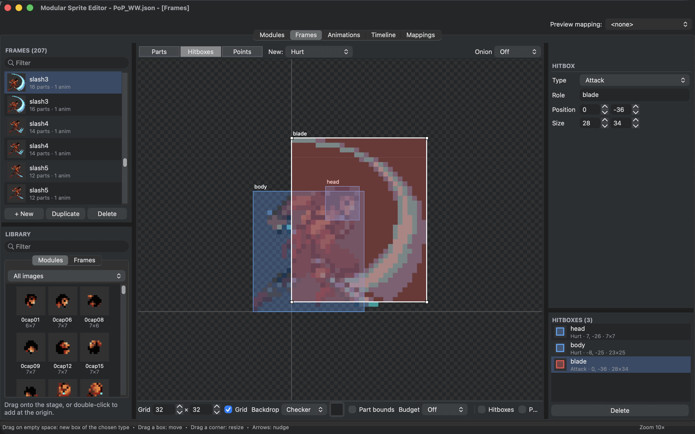
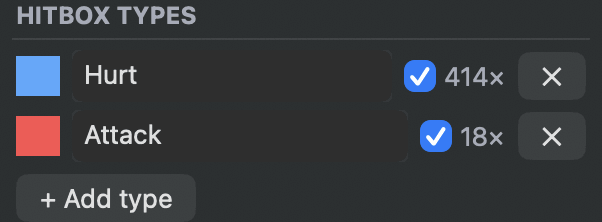
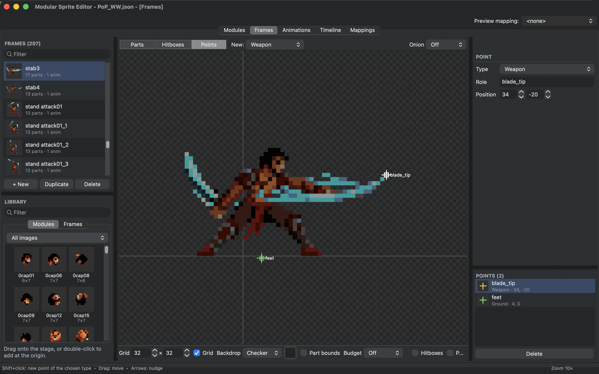
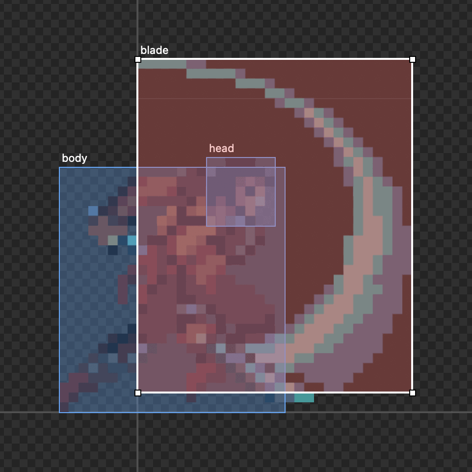
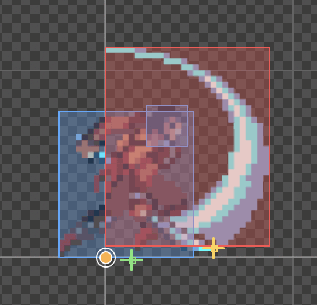

# Hitboxes and points

A game needs to know more about a pose than how it looks. Where can the character be hit? Where does the sword hurt? Where should a thrown dagger appear? Hitboxes and points answer these questions, and you set them on the frames you already draw.

<figure class="ms-shot" markdown="span">
  [{ width="1440" height="900" loading="lazy" }](../assets/images/screens/hitboxes.png)
  <figcaption>The Prince's slash in <strong>Hitboxes</strong> mode. <code>head</code> and <code>body</code> are <strong>Hurt</strong> boxes, <code>blade</code> is the <strong>Attack</strong> box over the sweep.</figcaption>
</figure>

You do not need them to make sprites look right. Add them when a programmer asks, or when you know the game will need them.

The Prince of Persia example has them on every pose: **Hurt** boxes for the head and the body, an **Attack** box on the poses where a blade strikes, and points at the feet and, in combat, at the tip of the blade.

## Hitboxes

Choose **Hitboxes** above the stage and, next to it in **New**, the type of box to draw. Then drag on empty space to draw a box of that type. Drag a box to move it, drag a corner to resize it, and nudge it with the arrow keys.

**Hitbox types** in the inspector lists the kinds of boxes your project uses, each with a colour, for example "Hurt" for where the character can be hit and "Attack" for where it hurts others. **+ Add type** makes a new one. The checkbox next to a type shows or hides its boxes on the stage. Deleting a type asks first if boxes still use it.

<figure class="ms-shot ms-shot--part" markdown="span">
  [{ width="301" height="111" loading="lazy" }](../assets/images/screens/hitboxes-types.png)
  <figcaption><strong>Hitbox types</strong>, with how many boxes use each. The inspector lists them when nothing is selected.</figcaption>
</figure>

## Points

Choose **Points** above the stage and the type in **New**. ++shift++-click to place a point of that type, drag it to move it. Points mark places: a hand that holds a weapon, the spot a projectile leaves from, where dust appears at the feet.

<figure class="ms-shot" markdown="span">
  [{ width="1440" height="900" loading="lazy" }](../assets/images/screens/points.png)
  <figcaption>A stab with two points: <code>blade_tip</code>, of type <strong>Weapon</strong>, and <code>feet</code>, of type <strong>Ground</strong>.</figcaption>
</figure>

## Roles

A box or point can have a **role**, a short name such as `head`, `blade` or `hand_front`. Roles let the game find the right box in every frame without counting them. Agree on the names with your programmer.

<figure class="ms-shot ms-shot--part" markdown="span">
  [{ width="481" height="481" loading="lazy" }](../assets/images/screens/hitboxes-stage.png)
  <figcaption>On the stage, each box and point shows its role.</figcaption>
</figure>

## Copy them to other frames

Right-click a frame in the list:

- **Copy Hitboxes & Points** and **Paste Hitboxes & Points** move them to another frame.
- **Copy Hitboxes to All Frames...** and **Copy Points to All Frames...** put them on every frame, for example a body box every pose needs. The editor asks whether to add them or replace what other frames have.

**Remove empty boxes** in the inspector deletes boxes without an area in every frame.

## They move with the animation

In an animation, a step's offset, flips and turns move its frame's hitboxes and points too. Turn on **Collision** and **Points** in the **Animations** tab's view bar to see them while the animation plays. While you arrange parts in the **Frames** tab, **Hitboxes** and **Points** in the view bar keep them visible.

<figure class="ms-shot ms-shot--part" markdown="span">
  [{ width="271" height="261" loading="lazy" }](../assets/images/screens/hitboxes-animation.png)
  <figcaption><strong>C06 slash</strong> at its second step, with <strong>Collision</strong> and <strong>Points</strong> on.</figcaption>
</figure>
