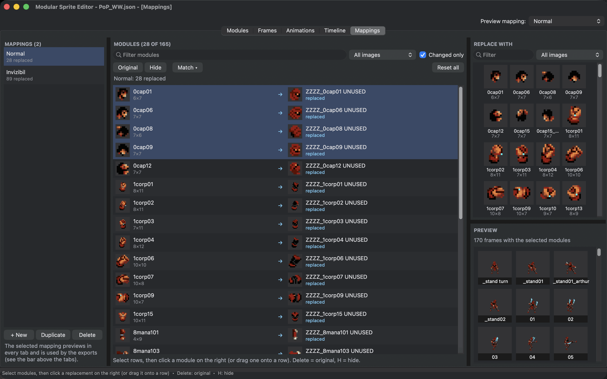

# Variants with mappings

A mapping says "wherever this module appears, show that one instead", or "show nothing". It changes every frame, animation and scene at once, without touching them. Use it for costume colours, damaged armour, an invisible state, or a whole new character that uses another character's animations.

{ .ms-pixel width="288" height="148" }

In the Prince of Persia example, the mapping "Normal" swaps 28 head, chest and arm modules for a hooded guard's. Every one of the Prince's 68 animations works for the guard too.

<figure class="ms-shot" markdown="span">
  
  <figcaption>The Mappings tab with "Normal" selected and only changed modules shown. The preview on the right shows frames with the selected modules, drawn with the mapping.</figcaption>
</figure>

## Make a mapping

Open the **Mappings** tab and choose **+ New** under the list. A new mapping changes nothing yet: every module shows itself.

The **Modules** table lists every module and what it shows under the mapping. Select rows, then click a module in **Replace with** on the right, or drag one onto a row. **Original** sets the selected rows back to themselves (++delete++), and **Hide** makes them disappear (++h++). **Reset all** sets every module back to the original.

**Changed only** shows just the modules this mapping replaces or hides. **Filter modules** and the image choice narrow the table down.

## Match a whole sheet at once

If you drew a variant as a second sheet, **Match ▾** saves you from mapping modules one by one:

- **Same Layout on Another Image...** maps every module of one image to the module at exactly the same place on another image. This is the quick way to a recoloured costume: copy the modules to the recoloured sheet (see [Reuse cuts on another image](modules.md#reuse-cuts-on-another-image)), then match.
- **Match Names...** replaces modules by name, for example every module whose name contains `_red` with the one named `_blue` instead.

## See it everywhere

The **Preview** under the palette shows the frames that use the selected modules, drawn with the mapping.

**Preview mapping** at the top of the window shows any mapping in every tab: frames, animations and scenes are drawn with it. It only changes the view. The exports use it too, as described in [For your programmer](../reference/programmers.md).

In a scene, each object can have [its own mapping](scenes.md#give-an-object-its-own-look), so the hero and the guard appear together.

## Tips

- A mapping can only swap modules that exist. Draw the variant parts, cut them as modules, then map.
- Keep a replacement the same size as the original, with its pivot in the same place, and it drops into every pose.
- In the game, the programmer chooses a mapping per character, so a mapping costs only the memory of its new parts.
