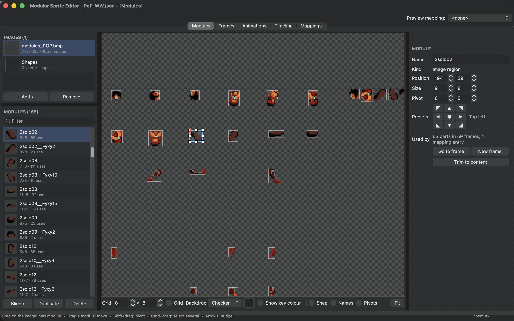
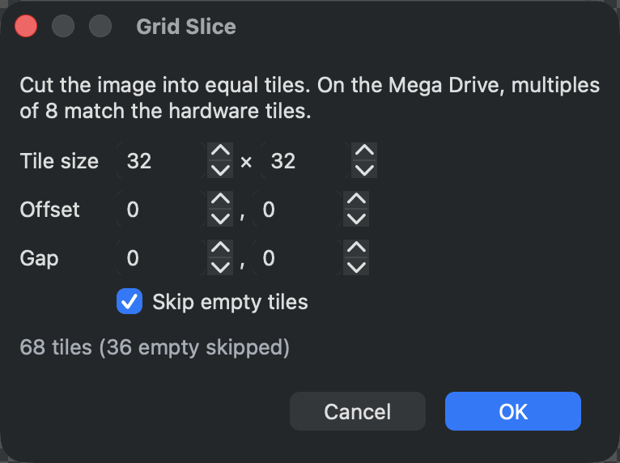
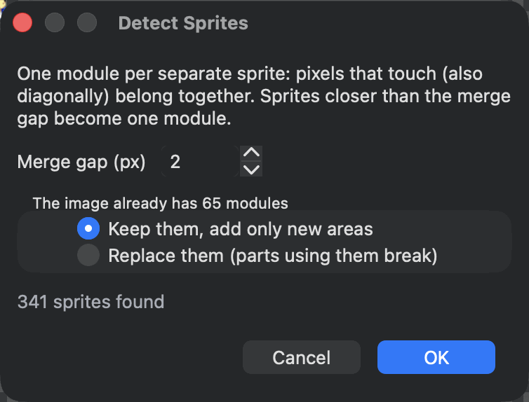
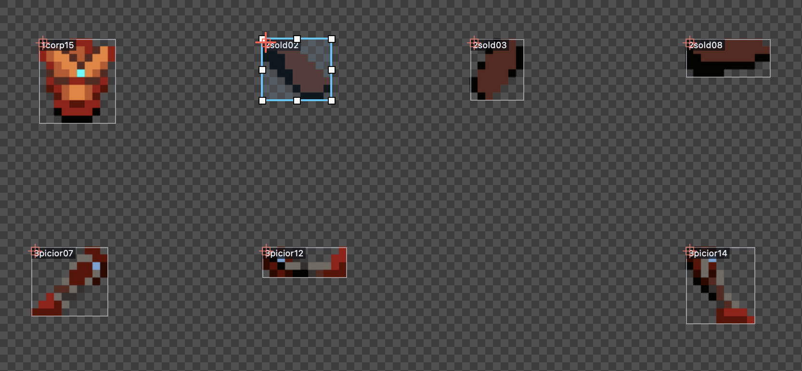
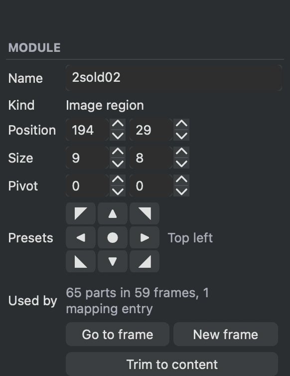

# Cut a sheet into modules

A module is one part of your artwork, cut from a sprite sheet: a head, a hand, a sword, a whole sprite if you like. Frames are built from modules, so the cleaner your modules, the easier everything after them becomes.

<figure class="ms-shot" markdown="span">
  
  <figcaption>The Modules tab with the Prince of Persia sheet. The selected module has handles; the inspector shows its position, size, pivot and where it is used.</figcaption>
</figure>

## Add your images

The **Images** list at the top left holds the sheets of your project. Choose **+ Add ▾ ▸ Image...** for one image or **Folder...** for every image in a folder. For a folder of single sprites, one file per pose, turn on **Make each image one module** in the folder window.

PNG with transparency works best. If your sheet uses a background colour instead, select the image, choose **Pick** next to **Key colour** in the inspector and click the colour. It becomes transparent everywhere the image is used. Turn on **Show key colour** in the view bar to see the original background again while you cut.

If you move an image on disk, its row shows that the file is missing. Select it and choose **Locate...** to point the project at the new place.

When you change an image in another program, for example in Aseprite, the editor shows the new pixels as soon as you switch back to it, in every tab.

## Draw a module

Drag a box on an empty part of the sheet to make a module. Then:

- drag the module to move it, or drag one of its handles to resize it;
- nudge it with the arrow keys, ++shift++ for 8 pixels at a time;
- turn on **Snap** in the view bar to snap to the grid size set next to **Grid**.

Click a module to select it, ++cmd++-click to add more to the selection, and ++cmd++-drag a box to select every module inside it. ++delete++ removes the selected modules. When frames still use them, the editor asks whether to remove those parts too or to keep them as missing parts, which **Tools ▸ Check Project** lists later.

**Trim to content** shrinks a module to the pixels inside it, which is handy after a quick, generous box.

## Let the editor cut for you

Two tools under **Slice ▾** cut a whole sheet at once:

**Grid slice...** cuts the sheet into equal cells. Set **Tile size**, and **Offset** and **Gap** if the cells have a margin or space between them. **Skip empty tiles** leaves out cells without any visible pixel.

**Detect sprites...** finds every group of touching pixels and makes it a module. **Merge gap** joins sprites closer than that many pixels, so a character with a separate sword or a dust cloud becomes one module.

Both windows show how many modules they will make while you change the settings. If the sheet already has modules, choose whether to keep them and add only new areas, or replace them.

<figure class="ms-shot ms-shot--part" markdown="span">
  [{ width="383" height="286" loading="lazy" }](../assets/images/screens/lesson-grid.png)
  <figcaption><strong>Grid slice...</strong> on the Adventurer sheet.</figcaption>
</figure>
<figure class="ms-shot ms-shot--part" markdown="span">
  [{ width="377" height="287" loading="lazy" }](../assets/images/screens/modules-detect.png)
  <figcaption><strong>Detect sprites...</strong> on the Sonic sheet.</figcaption>
</figure>

For sheets of finished sprites there is a third tool, **Auto modularize...**, which finds parts the sprites share. See [Find shared parts automatically](auto-modularize.md).

## Names and pivots

Double-click a module in the **Modules** list or press ++f2++ to rename it. Clear names such as `head_left` or `sword_swing2` help when you build frames.

<figure class="ms-shot ms-shot--part" markdown="span">
  [{ width="833" height="385" loading="lazy" }](../assets/images/screens/modules-names.png)
  <figcaption><strong>Names</strong> and <strong>Pivots</strong> in the view bar label every module and mark its pivot.</figcaption>
</figure>

The **pivot** is the point of the module that is placed when you use it in a frame. It is shown as a small red cross. Set it in one of three ways:

- ++shift++-drag on the sheet to move it;
- type it in **Pivot** in the inspector, counted from the module's top-left corner;
- choose one of the nine **Presets**. **Bottom** puts the pivot at the middle of the module's bottom edge, the usual choice for feet.

Pivots matter when parts swap. If every head of a character has its pivot at the neck, any head drops into place in any frame.

<figure class="ms-shot ms-shot--part" markdown="span">
  [{ width="291" height="377" loading="lazy" }](../assets/images/screens/modules-inspector.png)
  <figcaption>A selected module in the inspector.</figcaption>
</figure>

## See where a module is used

The inspector's **Used by** counts the frames, parts and mapping entries that use the selected module. **Go to frame** opens the first frame that uses it, and **New frame** makes a new frame with just this module on its origin.

The **Modules** list shows a thumbnail, the size and how often each module is used. A module used zero times is a candidate for cleaning up.

## Reuse cuts on another image

Select modules and copy them (++cmd+c++). Select another image and paste (++cmd+v++): the same areas are cut there. This is useful when you have a recoloured copy of a sheet with the same layout. A [mapping](mappings.md) can then swap between the two.

## Shapes

The **Shapes** entry in the **Images** list holds vector shapes: rectangles, ellipses, triangles, lines and markers, filled or outlined, in any colour. Drag on its canvas to make one and choose its kind in the inspector. Shapes work like any other module. They are good for placeholders, simple effects and quick markers, and they are drawn pixel-exact at every size.

## Tips

- Cut parts that repeat across poses: one forearm used in twenty frames saves nineteen drawings and their memory.
- A mirrored part does not need its own module. Flip it in the frame. Consoles such as the Mega Drive flip hardware sprites for free.
- Keep a part within the console's largest hardware sprite where you can, 32 by 32 pixels on the Mega Drive. See [Stay within the console's limits](hardware-budget.md).
