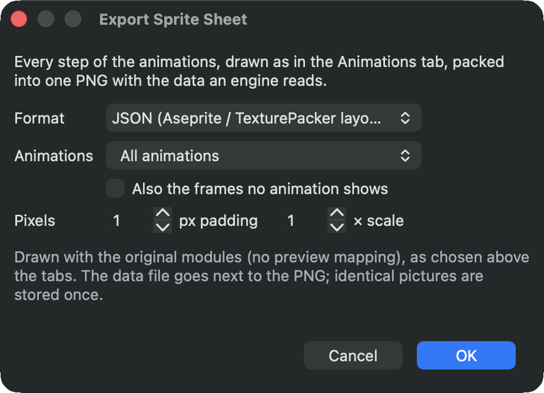

# Work with other tools

Your sprites can leave the editor for other engines and tools, and art drawn elsewhere can come in. Exports draw with the preview mapping and palette swap chosen above the tabs.

## Sprite sheets for game engines

**File ▸ Export ▸ Sprite Sheet (JSON, Godot, Unity)...** draws every step of your animations the way the Animations tab shows it (with its offset, flips and turns) and packs the pictures into one PNG. Identical pictures are stored once. Next to the PNG go the files the engine reads. Your hitboxes, points and step events go along, moved with each step like the picture.

<figure class="ms-shot ms-shot--part" markdown="span">
  [{ width="462" height="334" loading="lazy" }](../assets/images/screens/sheet-export.png)
  <figcaption>Choose the format, the animations and the pixels; then where to save the PNG.</figcaption>
</figure>

- **JSON (Aseprite / TexturePacker layout)** describes every step as a frame: where it is on the sheet, where it sits on a canvas shared by all of them, how long it shows, and the editor's origin as its pivot. Every animation becomes a tag with its direction and repeats. Each frame also lists its hitboxes, points and events, in pixels from the origin. Phaser, LÖVE, Defold, GameMaker and many other engines read this layout, and so does this editor's import.
- **Godot 4: SpriteFrames and a scene** writes a SpriteFrames resource (`.tres`) for an **AnimatedSprite2D**, and a scene (`.tscn`) with a character ready to use. Copy the PNG and the files next to it together into the Godot project.
- **Unity 6: sprites, clips and a prefab** writes the PNG's import settings (`.png.meta`), an animation clip for each animation, an **Animator Controller** and a **prefab** with a character ready to use. Copy them together into the project's **Assets** folder.

**Animations** exports all of them, the selected one or one [group](../start/tour.md#lists). **Also the frames no animation shows** adds those too. **Padding** keeps clear pixels between the pictures, so an engine never bleeds a neighbour in, and **Scale** makes every pixel larger.

### The character in Godot

Drag the `.tscn` into a scene, or instance it from code. Its origin is the editor's origin, the pixels stay crisp, and its **AnimationPlayer** has an animation for each of yours, which plays it the way the editor does: its tick rate and holds, loops, ping-pong, repeat counts, **Loop from** and the follow-up animation. The first one plays when the scene starts.

- Each hitbox is an **Area2D** under **Hitboxes**, named after its type and role, such as *Hurt head*. Its shape moves, changes size and switches off with the steps, so connect its signals to find what it touches.
- Each point is a **Marker2D** under **Points**, such as *Weapon blade_tip*, at the centre of the pixel it marks. It is hidden on steps without it.
- When a step with events starts, the scene's script emits the signal `sprite_event(event_name, value)`. Connect it to play a sound or deal a hit.

The `.tres` alone also plays in any **AnimatedSprite2D**, without the hitboxes, points and events.

### The character in Unity

Drag the prefab into a scene. Its **Animator** plays the controller, which has a state for each animation, the first one the default; a follow-up animation is a transition at the end of the clip. Each clip plays at the animation's tick rate, the way the editor does.

- Each hitbox is a child of **Hitboxes** with a trigger **BoxCollider2D**, named after its type and role, such as *Hurt head*. It moves, changes size and switches off with the steps. Unity reports trigger contacts when one of the two objects has a **Rigidbody2D**, so give your character one.
- Each point is a child of **Points** at the centre of the pixel it marks, and is switched off on steps without it.
- A step's events call `OnSpriteEvent(AnimationEvent e)` on the character's scripts: `e.stringParameter` is the event's name and `e.intParameter` its value. Without such a script they are ignored.

A unit is 100 pixels of the sheet, Unity's default for sprites. Export to the same folder again and Unity updates the sprites, clips and prefab in place: scenes that use the prefab keep it.

An animation that plays a few steps before it loops from a later one becomes two clips in both engines, *Run* and *Run loop*, the first followed by the second.

## PNG sequences and GIFs

- **File ▸ Export ▸ Selected Animation as PNG Sequence...** writes one picture per step, or one per tick for a steady frame rate in video tools. All pictures share one canvas, so the origin stays put.
- **Export GIF...** in the [Animations](animations.md) inspector writes one cycle of an animation, and **Export GIF...** in the scene settings of the [Timeline](scenes.md) writes a scene, on its background colour. Both are in **File ▸ Export** too.

## Bring in art from Aseprite

**File ▸ Import ▸ Aseprite File...** opens an `.aseprite` or `.ase` file the way Aseprite exports it: the visible layers flattened with their opacity. The editor packs the frames into one PNG next to the file, named after it with `.sheet.png` (it never writes over a file that is there), and makes:

- a module for each distinct picture and a frame for each Aseprite frame,
- an animation for each **tag**, with its direction (forward, reverse, ping-pong) and repeats, and the durations as holds at the tick rate that fits them best.

The origin of each frame is the bottom centre of the Aseprite canvas, where a character's feet usually are. Then cut the pictures into parts the frames share: **Tools ▸ Auto Modularize Image...** finds them, see [Find shared parts automatically](auto-modularize.md).

**File ▸ Import ▸ Sprite Sheet with JSON...** opens a sheet that Aseprite or TexturePacker exported with its JSON (hash or array): the PNG stays as it is and its rectangles become the modules. A pivot in the JSON becomes the origin.

The import opens as a new project, so **Save** asks for a new file. Anything it leaves out, such as a layer blend mode it draws as Normal or a tilemap layer, is listed once the import is done.

## Other formats

**File ▸ Import** also opens AuroraGT `.sprite` files and RetroAnimator projects, and **File ▸ Export ▸ RetroAnimator Project (\*.json)...** writes one. The Mega Drive and SNES exports are described in [For your programmer](../reference/programmers.md).
