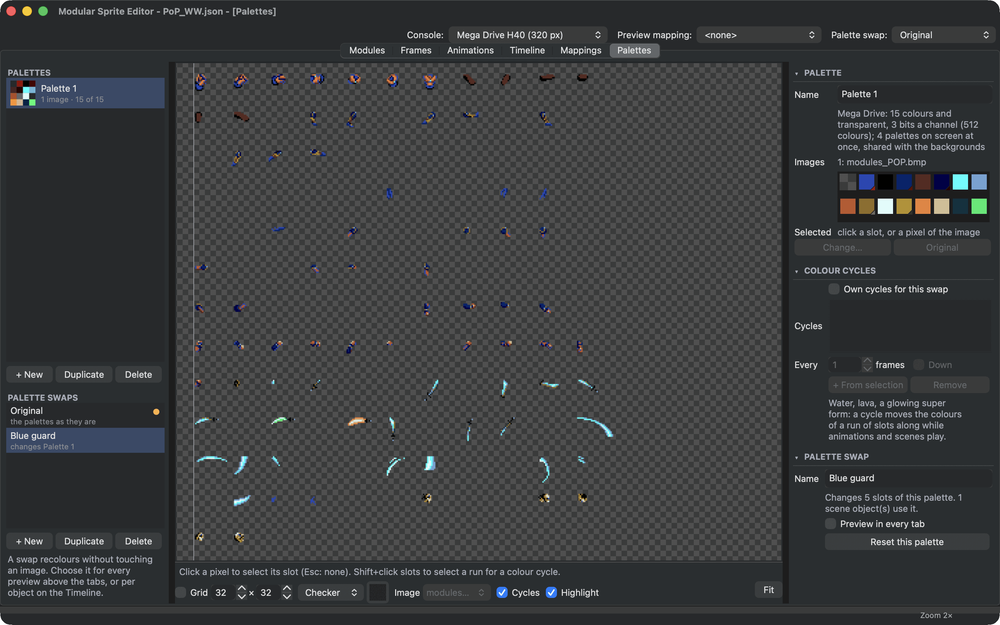
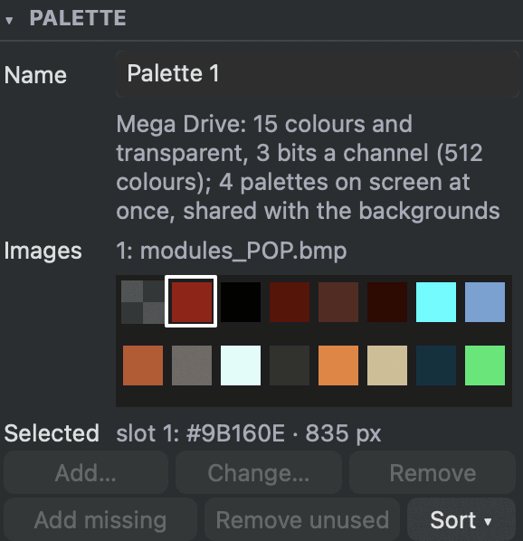
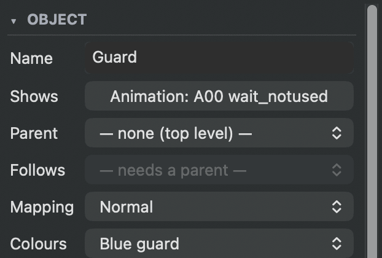
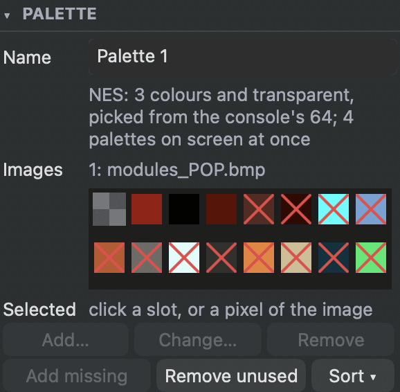

# Colours, palettes and swaps

Consoles draw sprites through **palettes**: a few colours that a sprite's pixels pick from. On the Mega Drive a palette holds 15 colours plus transparent, and the sprites on screen use up to four palettes at once. Because a pixel only says *which* colour of its palette it is, the same art can show in other colours just by changing the palette: a guard in other clothes, a hit flash, the second player.

The **Palettes** tab holds the project's palettes, the **palette swaps** that recolour them and the **colour cycles** that make colours move.

<figure class="ms-shot" markdown="span">
  
  <figcaption>The Prince of Persia palette with the <strong>Blue guard</strong> swap: the slots it changes show their new colour.</figcaption>
</figure>

## Palettes and their slots

Every image belongs to a palette. Choose it in the **Modules** tab: select the image and pick its **Palette** in the inspector, or **New palette...** for one of its own. Images in the same palette share its colours.

A palette's colours sit in numbered **slots**, in the order you see in the inspector, and they stay there: palette swaps and colour cycles refer to slots, and the console stores them in this order. When an image joins a palette, or changes on disk, the colours it uses that the palette lacks go into free slots.

<figure class="ms-shot ms-shot--part" markdown="span">
  [{ width="289" height="299" loading="lazy" }](../assets/images/screens/palettes-slots.png)
  <figcaption>The slots of the palette, as the console shows them.</figcaption>
</figure>

- **Click a slot** to select it: the preview keeps the colour of the pixels that use it and fades every other pixel to a grey ghost (turn **Highlight** off in the view bar to see the image as it is). Or click a pixel of the preview to find its slot. Click the selected slot again (or press ++esc++) to select none and see the whole image. ++shift++-click selects a run of slots.
- **Change...** (or a double-click) gives a slot another colour. The editor snaps it to a colour the console can show. A slot your images use keeps its colour: recolour the art with a palette swap instead, so the original stays.
- **Add missing** puts the colours the images use that the palette lacks into free slots. **Remove unused** removes slots no pixel uses, and **Sort** orders the slots dark to light, by hue or by how much they are used.
- **Drag a slot** to move it. Swaps and cycles move along, and so do the pixels: nothing changes on screen.

**Tools ▸ Check Project** warns when a palette has no room for its images' colours (those pixels take the nearest colour, on the console too), when its slots lack a colour its images use, with a fix that adds them, when it holds more colours than the console shows, with a fix that keeps the most used, and when two slots hold the same colour.

## Palette swaps

A **palette swap** recolours slots without touching any image. Make one with **+ New** under **Palette swaps**, select it, select a slot and choose **Change...**: the slot shows the new colour under this swap. **Original** gives the slot its palette's colour back. One swap can change several palettes.

Use a swap where you would otherwise copy and recolour a sheet: the second player, an enemy in other clothes, a flash when a character is hit, poisoned skin. On the console a swap costs no video memory: the art is stored once, and the game picks the colours when it draws.

Swaps are chosen the way [mappings](mappings.md) are:

- **For the preview:** **Palette swap** above the tabs, or **Preview in every tab** in the swap's settings. Every canvas, thumbnail and export then draws with it.
- **For a scene object:** **Colours** in the Timeline inspector. **Inherit** takes the parent's swap (at the top level the preview's), **Original** the palettes as they are, or choose a swap. Mapping and colours are independent: the guard in the *Swordfight* example uses the **Normal** mapping and the **Blue guard** swap.
- **In the game:** the programmer picks the swap when drawing each character.

<figure class="ms-shot ms-shot--part" markdown="span">
  [{ width="311" height="210" loading="lazy" }](../assets/images/screens/scene-colours.png)
  <figcaption>The guard of the <em>Swordfight</em>: his own mapping and his own colours.</figcaption>
</figure>

## Colour cycles

A **colour cycle** moves the colours of a run of slots along, one slot every few video frames: water that flows, lava that glows, a super form that shimmers. ++shift++-click the run of slots and choose **+ From selection** in **Colour cycles**. **Every** sets how many video frames each step lasts (60 frames make a second), and **Down** turns the other way.

Cycles turn in the Palettes tab (turn **Cycles** off in the view bar to stop them) and while animations and scenes play. A palette swap runs its palette's cycles, or cycles of its own (**Own cycles for this swap**). In the game they turn the same way.

## See what the console shows

**View ▸ Console Colours** (++cmd+shift+p++) shows every canvas the way the console will: each image through its palette, in the colours the console can show (512 on the Mega Drive), and half-transparent pixels fully opaque, as the console has no half-transparent sprite pixels. Turn it on before you export to spot merged colours and small colour shifts.

## Choose the console

The palettes follow the console your project is made for. Choose it in **Console**, above the tabs: Mega Drive, SNES, NES, Game Boy Advance or Game Boy, each with its setup (screen mode or sprite sizes). It decides how many colours a palette holds and which colours a slot can take:

| | A palette holds | A slot's colour |
| --- | --- | --- |
| Mega Drive | 15 and transparent | one of 512 |
| SNES, Game Boy Advance | 15 and transparent | one of 32,768 |
| NES | 3 and transparent | one of the console's 64 |
| Game Boy | 3 and transparent | one of its 4 shades of green |

On the NES and the Game Boy, **Change...** opens a grid of the console's colours to pick from. The NES's are numbered $00 to $3F, the way programmers write them.

When you switch to a console with smaller palettes, palettes with more colours than it holds can **Keep the Most Used**, the colours their images use most, or **Keep All**. Then the console shows the first colours of each palette, and the others wait in their slots, crossed out, for a console with bigger palettes. Drag a crossed-out colour to an earlier slot to show it instead, or let **Check Project** keep the most used later.

<figure class="ms-shot ms-shot--part" markdown="span">
  [{ width="289" height="283" loading="lazy" }](../assets/images/screens/palettes-console.png)
  <figcaption>The Prince of Persia palette in a project for the NES: the console shows the first three colours.</figcaption>
</figure>

The editor exports for the Mega Drive and the SNES so far, and each export makes palettes for its own console: the Mega Drive export of a project made for the NES makes Mega Drive palettes, in the colours the Mega Drive shows, and its report says so. [Consoles](../reference/consoles.md) lists what the editor knows about each console.
