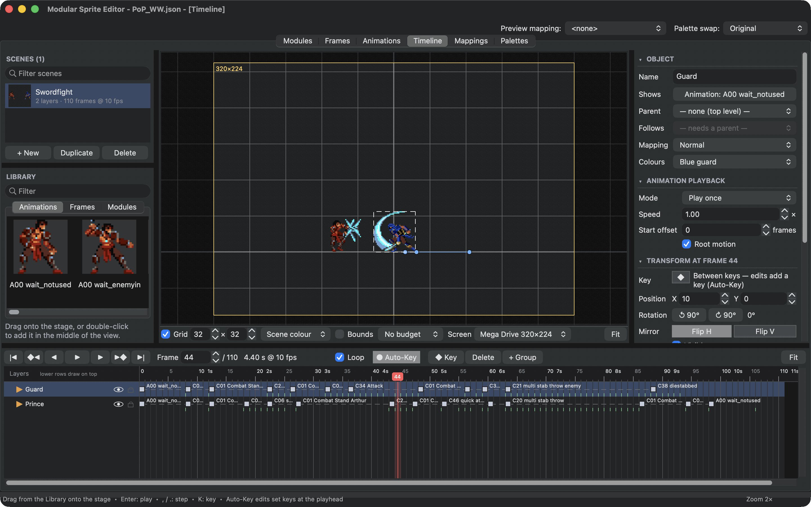
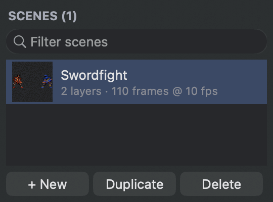
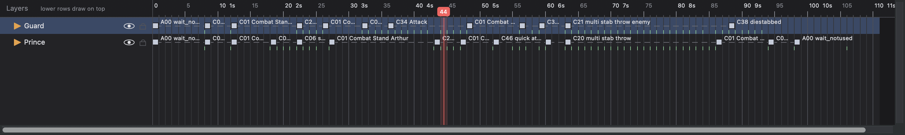
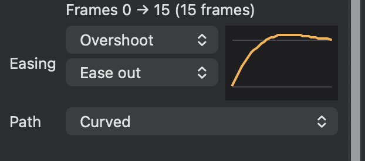
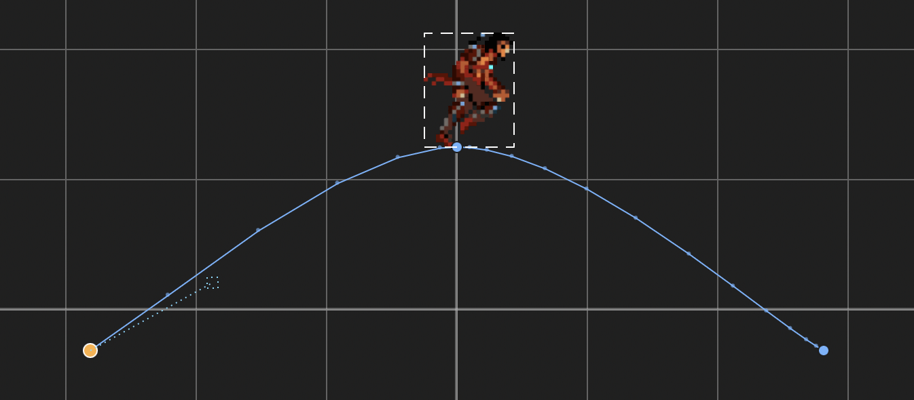
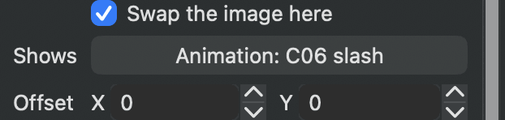
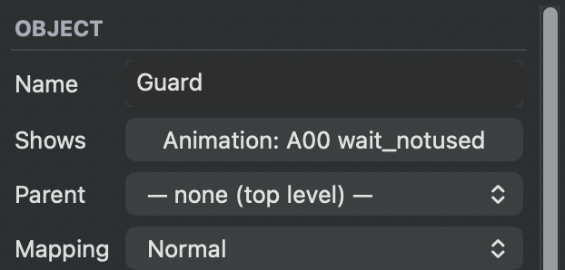

# Stage a scene

The **Timeline** tab puts several things in one scene: characters playing animations, single frames, modules. You move them with keys over time, flip them, put them behind each other and switch their animations on cue. Use scenes for cutscenes, intros, attract modes, or to test two characters together.

<figure class="ms-shot" markdown="span">
  
  <figcaption>The Swordfight at frame 44. Each fighter is one layer; the labels on the timeline name the animation each key switches to.</figcaption>
</figure>

## Scenes

The **Scenes** list at the top left holds the project's scenes, each with a picture of its first frame, like the lists of the other tabs: **+ New**, **Duplicate** and **Delete** below it, a double-click or ++f2++ renames, and dragging reorders. Click a scene to show it; its settings appear in the inspector: its name, **Frame rate**, **Length** in frames, whether it loops, and its background colour. Click the scene again, or empty space on the stage, to bring the settings back after selecting a layer.

<figure class="ms-shot ms-shot--part" markdown="span">
  [{ width="270" height="200" loading="lazy" }](../assets/images/screens/scenes-list.png)
  <figcaption>The <strong>Scenes</strong> list of the Prince of Persia example.</figcaption>
</figure>

The timeline counts in frames of the scene. A scene at 10 frames a second plays an animation at 10 ticks a second one step per frame, which keeps timing easy to read.

## Add objects

Drag an animation, frame or module from the **Library** onto the stage, or double-click it to add it in the middle of the view. Each object becomes a layer. **+ Group** adds an empty object that other layers can follow.

Layers are listed in drawing order: lower rows draw on top. Drag a layer up or down to change the order, or onto another layer to make it that layer's child. A child moves, flips and turns with its parent. The eye hides a layer, the lock stops it from being picked on the stage.

## Several layers at once

++shift++-click layers in the list to select a range, ++cmd++-click to add or remove one. On the stage, ++shift++- or ++cmd++-click objects, or drag over empty space to select everything the box touches. Dragging any of them moves them all; the arrow keys, ++h++, ++v++, ++r++, **Duplicate** and **Delete** work on all of them too. The inspector shows the last one you clicked; its **Mapping** and **Colours**, and the playback **Mode**, **Speed** and **Root motion**, change all of them.

**Copy** (++cmd+c++) and **Paste** (++cmd+v++) work on layers as well, with their children: paste them into another scene to reuse a character or a whole group there. Next to the original, the copy's name gets "copy" added.

## Keys

A key stores where an object is, how it is flipped and turned, and whether it is visible, at one frame. The object moves and turns smoothly to the next key, while a flip or a change of visibility happens exactly at the key's frame.

With **Auto-Key** on, moving, flipping or turning an object on the stage sets a key at the playhead. With it off, the same edits move all of a layer's keys together. ++k++ sets a key at the playhead, and ++shift+k++ adds or removes one.

On the timeline, drag keys to retime them, double-click a track to add a key and drag over empty track to select several keys. ++shift++-click adds a key to the selection, ++cmd++-click adds or removes one. Copy and paste keys with ++cmd+c++ and ++cmd+v++: they paste at the playhead.

Under a layer that plays an animation, short marks along the bottom of its track show each frame where the animation moves on to its next pose, as the scene plays it. Put keys on them to time a move to a pose, and hover over a mark to see its frame.

<figure class="ms-shot" markdown="span">
  [{ width="1426" height="215" loading="lazy" }](../assets/images/screens/scene-timeline.png)
  <figcaption>The Swordfight's two layers. Every key swaps in an animation, the labels name them, and the marks along the bottom show each new pose.</figcaption>
</figure>

## Motion between keys

The bar between two keys shows how the object moves there, by name. Right-click it, or use **Motion to next key** in the inspector, to choose the easing:

- **Linear** moves at an even speed, **Hold** stays put and jumps at the next key.
- **Gentle**, **Normal**, **Strong**, **Stronger**, **Strongest**, **Exponential** and **Circular** speed up and slow down more and more. Choose whether the motion eases in, out or both.
- **Overshoot**, **Elastic** and **Bounce** go past the target and settle.

**Path** chooses a straight or curved path. On a curved path, drag the handles on the stage to shape the curve; **Reset curve handles** brings back the automatic curve. The stage draws the path with a dot for every frame, so you can see where the motion is fast or slow.

<figure class="ms-shot ms-shot--part" markdown="span">
  [{ width="311" height="138" loading="lazy" }](../assets/images/screens/scene-motion.png)
  <figcaption><strong>Overshoot</strong>, <strong>Ease out</strong>, on a <strong>Curved</strong> path.</figcaption>
</figure>
<figure class="ms-shot ms-shot--part" markdown="span">
  [{ width="673" height="295" loading="lazy" }](../assets/images/screens/scene-path.png)
  <figcaption>The curved path, with a dot for every frame.</figcaption>
</figure>

## Change the animation at a key

Select a key and turn on **Swap the image here** in the inspector. From this key on, the object shows another animation, frame or module. An animation swapped in at a key plays from its first step at that key, so you can cue an attack, a hit and a fall exactly when they should happen. **Offset** shifts the swapped image, for when two animations do not line up.

<figure class="ms-shot ms-shot--part" markdown="span">
  [{ width="311" height="74" loading="lazy" }](../assets/images/screens/scene-swap.png)
  <figcaption>The Prince's key at frame 22 swaps in his slash.</figcaption>
</figure>

**Animation playback** in the inspector sets how an object's animations play. **Mode** is **As animated** for new objects: the animation plays exactly as in the **Animations** tab and in the game, so a *Play once* animation stops on its last step, repeat counts and "loop from" apply, and when it ends its follow-up animation takes over. **Loop**, **Play once**, **Ping-pong** and **Loop backwards** override that and keep playing the one animation. **Speed** plays it faster or slower, and **Start offset** starts the object's own animation a few frames in.

**Root motion** lets the object move with its animation's step offsets, the way a run moves forward. It follows the object's mirror: a fighter flipped to face left steps forward to the left.

## Give an object its own look

**Mapping** in the inspector chooses the [mapping](mappings.md) the object is drawn with. **Inherit** uses the parent's mapping, or for top-level objects the preview mapping at the top of the window. **Original modules** always shows the original parts. **Colours** does the same for [palette swaps](palettes.md#palette-swaps). In the Swordfight, the guard is the Prince's animations with the "Normal" mapping, in the colours of the "Blue guard" swap.

<figure class="ms-shot ms-shot--part" markdown="span">
  [{ width="311" height="180" loading="lazy" }](../assets/images/screens/scene-mapping.png)
  <figcaption>The guard's settings: the Prince's animations, drawn with the <strong>Normal</strong> mapping.</figcaption>
</figure>

## Follow a point

A child can sit on a point of its parent's frames and follow it from frame to frame: a sword in a hand, a spark on a blade, a rider in a saddle. Give the parent's frames points with a role in the [Frames](hitboxes-points.md) tab, make the object a child of it, and choose the role under **Follows** in the inspector. The object then sits on that point in every frame, mirrors and turns with the parent, and hides on frames that have no such point. Its keys now say where it sits relative to the point.

Choosing **Follows** keeps the object where it is at the playhead; giving it another parent ends the following. **Tools ▸ Check Project** warns when no frame of the parent has the point.

## See it on screen

**Screen** in the view bar outlines a console screen: Mega Drive, SNES, NES, Game Boy Advance or Game Boy. The scene's origin sits where the Mega Drive demo shows scenes, in the middle and three quarters down, so what is inside the outline is what fits on the console's screen. The **Budget** overlay counts the hardware sprites of everything in view at the playhead.

Press ++enter++ to play the scene. ++comma++ and ++period++ step one frame, ++shift+comma++ and ++shift+period++ jump between the selected layer's keys. **View ▸ Play at 50 Hz** plays it at the speed of a PAL console.

**Export GIF...** in the scene settings writes the scene as an animated GIF on its background colour.

The [Inside the Swordfight](../examples/swordfight.md) page shows how a finished scene is put together.
