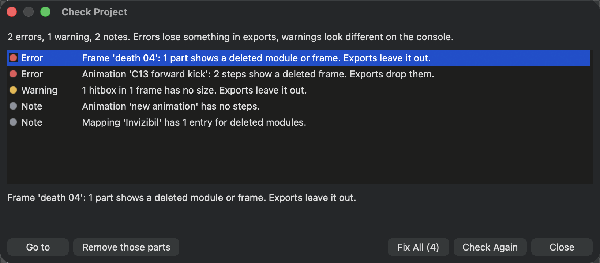
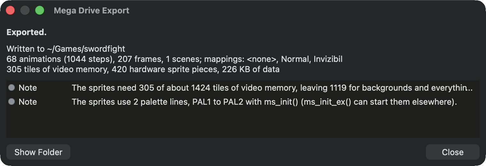

# For your programmer

This page is for the moment your sprites go into a game. Share it with your programmer, or send them straight to the technical documentation in the [source code repository](https://github.com/leissler/modular-sprite-editor).

## What to hand over

The project file (`.json`) and its images. The project stores image paths relative to itself, so keep them in the same folder structure and send the folder. Projects are plain text, which also makes them easy to keep in version control together with the game.

## Check the project first

**Tools ▸ Check Project** lists everything an export would leave out or show differently from the editor:

- **Errors** lose something: a step whose frame was deleted, a part whose module is gone, a missing image.
- **Warnings** look or behave differently: more colours than the console shows at once, half-transparent pixels, names that become the same name in the game's code.
- **Notes** are worth knowing but harmless, such as an empty animation.

<figure class="ms-shot ms-shot--part" markdown="span">
  [{ width="820" height="360" loading="lazy" }](../assets/images/screens/check-project.png)
  <figcaption>Each issue says what an export would do with it. The second button is the fix for the selected issue.</figcaption>
</figure>

Select an issue and choose **Go to** to see the item, or **Fix** where the editor knows a fix, for example removing the steps whose frame is gone. **Fix All** repairs everything it can at once, and **Undo** takes any fix back.

## Mega Drive (SGDK)

The Mega Drive was the first console with an exporter and a runtime; the [SNES](#snes-pvsneslib) is the second.

`export_sgdk`, on the [release page](https://github.com/leissler/modular-sprite-editor/releases/latest) next to the editor, turns a project into data for a Mega Drive game made with [SGDK](https://github.com/Stephane-D/SGDK). The source code includes a small runtime that draws it.

- Everything is baked into one data file: tiles and palettes, frames, animations, scenes, hitboxes and points with their types and roles, step events, and every mapping.
- Each palette gets a palette line of its own, with its colours in the order of the **Palettes** tab: Palette 1 goes into the first line the game gives the runtime, Palette 2 into the next, and so on, followed by the palette swaps' versions of the palettes they change.
- The game picks a [palette swap](../guide/palettes.md#palette-swaps) when it draws a character, the way it picks a mapping; a swap costs no video memory. The colour cycles turn with one call per video frame.
- Animations play on the console exactly as in the editor's preview, tick for tick, including loop-from steps, repeat counts and follow-up animations.
- The game chooses a mapping when it draws a character, so several characters can share one set of animations.
- Scenes play as they look on the Timeline, including objects with their own mapping or colours and objects that follow a point of their parent.
- Each step lasts the video frames the preview shows it for: the game counts frames at 60 a second, so tick rates that do not divide 60 round each step, and a 50 Hz console plays everything at five sixths of the speed (**View ▸ Play at 50 Hz** previews it).
- The numbers of the budget overlay are the exporter's own, so a pose that fits in the editor fits on the console.

**File ▸ Export ▸ Mega Drive (SGDK)...** writes the data into the game's SGDK project folder. Choose the folder and which mappings to include; the editor remembers both for the project. The game's own resources stay as they are: the export adds one line for its data file. The report afterwards shows what the game gets: how much of the console's video memory the sprites take, colours that had to be merged, and anything **Check Project** finds.

<figure class="ms-shot ms-shot--part" markdown="span">
  [{ width="760" height="260" loading="lazy" }](../assets/images/screens/export-report.png)
  <figcaption>The report after exporting the Prince of Persia example.</figcaption>
</figure>

The game's folder needs the runtime from the source code. The demo project in `examples/sgdk/sgdk_demo` has it and shows every module, frame, animation and scene with live profiling. `export_sgdk` does the same from the command line, for build scripts; `--strict` makes it fail when the project has errors:

```text
export_sgdk --project-json my_project.json --output-demo-dir path/to/sgdk_demo
```

The [SGDK guide in the repository](https://github.com/leissler/modular-sprite-editor/blob/main/examples/sgdk/README.md) covers the runtime, its functions and its limits.

## SNES (PVSnesLib)

The source code includes an exporter and a runtime for SNES games made with [PVSnesLib](https://github.com/alekmaul/pvsneslib). The runtime has the same functions as the Mega Drive's, so a game draws, plays and re-skins its characters the same way, with everything listed for the Mega Drive above: palettes and swaps, colour cycles, animations tick for tick, scenes, hitboxes, points and events.

- The SNES draws sprites as squares in two sizes a game chooses for the whole screen: 8 and 16 pixels, 8 and 32, up to 32 and 64. The export cuts every part into those squares, the way the budget overlay shows them for that pair.
- Every tile stays in video memory, in the SNES's two sprite tables of 256 tiles. The budget overlay and **Check Project** count them for the project's sizes when the project is made for the SNES (**Console**, above the tabs).
- Each palette gets one of the eight sprite palettes, in the order of the **Palettes** tab, followed by the palette swaps' versions of the palettes they change.

**File ▸ Export ▸ SNES (PVSnesLib)...** writes the data into the game's PVSnesLib project folder. Choose the folder, which mappings to include and the sprite sizes: the list shows how many of the 512 tiles each pair needs, so you can see which ones fit. The editor remembers your choices for the project, and the report afterwards shows what the game gets.

The game's folder needs the runtime from the source code. The demo project in `examples/snes/snes_demo` has it: it starts on the *Swordfight* and shows every module, frame, animation and scene at 60 frames a second. The release page has it as `ModularSpriteEditor-snes-demo.zip`: the ROM, to open in a SNES emulator, and the project, to build again with your own export. It builds with PVSnesLib's `make` on macOS and Linux, and on Windows with `build_windows.ps1` in the project, which needs only PVSnesLib's Windows release, no MSYS2. The exporter also runs from the command line:

```text
python3 examples/snes/tools/export_snes.py --project-json my_project.json --output-dir path/to/snes_game
```

The [SNES guide in the repository](https://github.com/leissler/modular-sprite-editor/blob/main/examples/snes/README.md) covers the runtime, its functions, its limits and how to build the demo.

## Other exports

- **File ▸ Export ▸ Sprite Sheet (JSON, Godot, Unity)...** packs every step into one PNG, the pivot on the editor's origin, with JSON in the Aseprite / TexturePacker layout, a Godot 4 SpriteFrames resource and scene, or Unity's sprites, clips, Animator Controller and prefab. Hitboxes, points and step events go along: as JSON per frame, as Area2D shapes, Marker2D points and the signal `sprite_event` in Godot, as trigger colliders, child transforms and `OnSpriteEvent` calls in Unity. See [Work with other tools](../guide/other-tools.md).
- **File ▸ Export ▸ RetroAnimator Project (\*.json)...** writes a RetroAnimator project with a picture for every part, drawn with the preview mapping. Its report lists what RetroAnimator has no place for, such as step events, loop-from steps, follow-ups and scenes. Exported to the same file again, it removes the part pictures it wrote last time and no longer uses; nothing else in the parts folder is touched.
- **Export GIF...** in the **Animations** tab and in the Timeline's scene settings writes an animation or a scene, and **File ▸ Export** a PNG sequence of an animation, for sharing and reviews.

## Importing

**File ▸ Import** opens Aseprite files, sprite sheets with Aseprite or TexturePacker JSON, AuroraGT `.sprite` files and RetroAnimator projects, so you can bring existing sprites into the editor. If the file has something the editor can't read, or names an image it can't find, the editor lists it once the import is done. An imported sprite is a new project: **Save** asks where to put it and never writes over the file you imported.

## The project format

The project file format is documented in the repository's [`docs/FILE_FORMAT.md`](https://github.com/leissler/modular-sprite-editor/blob/main/docs/FILE_FORMAT.md). The editor upgrades older projects when it opens them.
