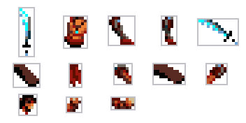
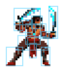
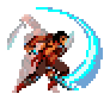
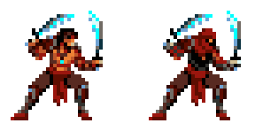

# Welcome to Modular Sprite Editor

Many classic console characters are not drawn as whole pictures. They are built from small parts: a head, a torso, an arm, a sword. Each pose reuses the same parts in new positions, which saves video memory and lets you change a character by changing a few pieces.

Modular Sprite Editor is made for working this way. You cut a sprite sheet into parts, build poses from them, animate the poses and stage scenes with several characters. Along the way it shows what your sprites cost on the console, so there are no surprises when they get there. The Sega Mega Drive is the first console it supports, and more will follow.

These guides are for artists and animators. You do not need to program to follow them. When it is time to hand your work to a programmer, [For your programmer](../reference/programmers.md) explains what to give them.

## Where would you like to start?

  <a href="install/"><strong>Get the editor</strong>Download it for Windows, macOS or Linux and open the examples.</a>
  <a href="first-sprite/"><strong>Make your first animated sprite</strong>From a sprite sheet to an animation that plays.</a>
  <a href="tour/"><strong>Find your way around</strong>The five tabs and how to move around the canvas.</a>
  <a href="../examples/"><strong>Learn from an example</strong>Open a finished project and take it apart.</a>

## Five words to know

<figure markdown="span">{ width="264" height="132" loading="lazy" }<figcaption>Modules</figcaption></figure>
<figure markdown="span">{ width="99" height="111" loading="lazy" }<figcaption>A frame</figcaption></figure>
<figure markdown="span">{ width="138" height="126" loading="lazy" }<figcaption>An animation</figcaption></figure>
<figure markdown="span">{ width="306" height="162" loading="lazy" }<figcaption>A scene</figcaption></figure>

A **module** is one part cut from your sprite sheet, such as a head or a sword. Modules are the pieces everything else is built from.

A **frame** is a pose made from modules. The same module can appear in many frames, flipped or turned.

An **animation** is a sequence of frames, each held for a number of ticks.

A **scene** puts animations, frames or modules on a timeline, so you can stage a moment with several characters.

A **mapping** swaps some modules for others everywhere at once. Use it for recolours, armour changes or a whole new character that shares the animations.

{ .ms-pixel width="216" height="111" loading="lazy" }

The [glossary](../reference/glossary.md) explains the other terms you will meet.

## A good first hour

1. [Get the editor](install.md) and open the Prince of Persia example.
2. Play a few animations in the **Animations** tab and open the **Swordfight** scene in the **Timeline** tab.
3. Follow [Your first animated sprite](first-sprite.md) with the Adventurer sheet or a sheet of your own.
4. Read [Build frames from parts](../guide/frames.md) and make a pose from modules.
5. Turn on the [budget overlay](../guide/hardware-budget.md) and see what your pose costs on the console.

## About this guide

This edition describes Modular Sprite Editor **0.6**. If your editor looks different, check which release you downloaded. The [release notes](../reference/releases.md) list what changed.
