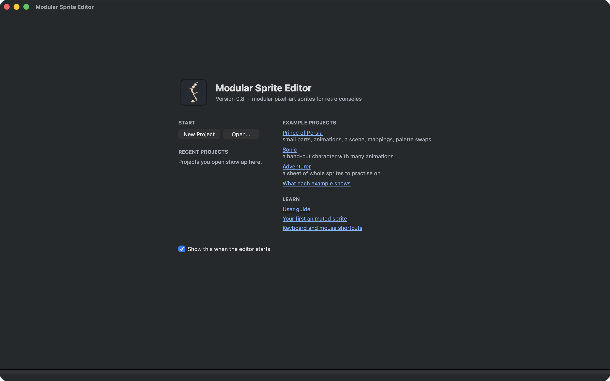
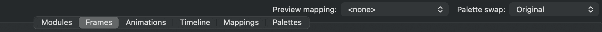
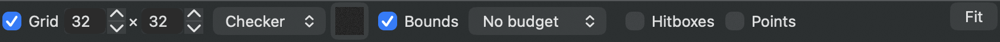
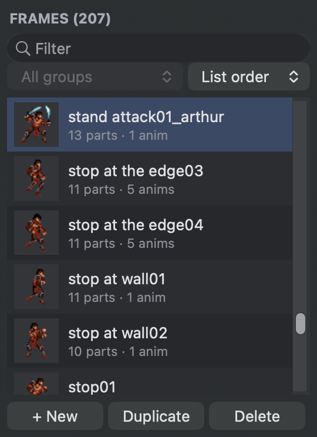

# A tour of the editor

The editor keeps one project open at a time: your images, the modules cut from them, the frames, animations, scenes, mappings and palettes. Six tabs show the same project from different sides.

When it starts without a project, the editor shows its welcome screen: start a new project, open one, pick up a recent project, or open one of the example projects. **Help ▸ Welcome Screen** brings it back, and **Help ▸ User Guide** opens this guide.

<figure class="ms-shot" markdown="span">
  [{ width="1440" height="900" loading="lazy" }](../assets/images/screens/welcome.png)
  <figcaption>The welcome screen at the first start.</figcaption>
</figure>

<figure class="ms-shot" markdown="span">
  
  <figcaption>The Frames tab. Every tab has the same layout: lists on the left, the canvas in the middle with its view bar below, and the inspector on the right. Click a section's title in the inspector to fold it away; it stays folded.</figcaption>
</figure>

## The six tabs

<figure class="ms-shot ms-shot--part" markdown="span">
  [{ width="1005" height="55" loading="lazy" }](../assets/images/screens/tour-top.png)
  <figcaption>The six tabs, and on the right the preview mapping and palette swap.</figcaption>
</figure>

**Modules** shows your images. Here you cut them into modules and set each module's pivot, the point that is placed when the module is used in a frame. See [Cut a sheet into modules](../guide/modules.md).

**Frames** is where you build poses from modules and other frames. It also holds the hitboxes and points a game needs. See [Build frames from parts](../guide/frames.md).

**Animations** puts frames in order and times them in ticks. See [Animate](../guide/animations.md).

**Timeline** stages scenes: several objects that move, flip and change their animations over time. See [Stage a scene](../guide/scenes.md).

**Mappings** swaps modules for others to make variants. See [Variants with mappings](../guide/mappings.md).

**Palettes** holds the colours your images use, palette swaps that recolour them and colour cycles. See [Colours, palettes and swaps](../guide/palettes.md).

Switch tabs with the tab bar or with ++cmd+1++ to ++cmd+6++ (++ctrl++ on Windows and Linux).

## The preview mapping and palette swap

At the top right, **Preview mapping** chooses the mapping every tab shows. Leave it at **<none>** to see the original modules. Choose a mapping to see every frame, animation and scene with its replacements, without changing anything. **Palette swap** next to it does the same for colours: every tab shows the art recoloured, and the exports draw with it.

## Moving around the canvas

Every canvas works the same way:

- **Zoom** with the mouse wheel, two fingers on a trackpad or a pinch. The zoom glides while you scroll and then settles on a whole pixel size (1×, 2×, 3× and so on), so pixels always stay square.
- **Pan** by holding ++space++ and dragging, by dragging with ++alt++ held, or with the middle mouse button.
- Rather scroll to move around, as most Mac apps do? Turn on **View ▸ Scroll Moves the View**: then scrolling moves the view, and a pinch or ++cmd++ + scroll zooms. The Animations step sequence and the Timeline follow the same choice.
- **Fit** everything into view with ++cmd+0++. ++cmd+shift+0++ shows actual pixels.

The view bar under each canvas holds the view options: **Grid** and its size, the backdrop behind the artwork (**Checker** or a **Colour**), **Bounds**, which outlines every module in a pose, and the [hardware budget overlay](../guide/hardware-budget.md) (**No budget** until you choose a console mode). These only change what you see, never your project. On a narrow window the bar wraps into a second row.

<figure class="ms-shot ms-shot--part" markdown="span">
  [{ width="841" height="36" loading="lazy" }](../assets/images/screens/tour-viewbar.png)
  <figcaption>The view bar of the <strong>Frames</strong> tab.</figcaption>
</figure>

## Lists

Lists work the same in every tab. **+ New**, **Duplicate** and **Delete** sit under the list. Double-click a name or press ++f2++ to rename it, drag rows to reorder them, and type in **Filter** to find something by name. Thumbnails show what each entry looks like.

The long lists, frames and animations, also have **groups**: give an entry a group in the inspector (or with **Group** in the list's right-click menu), then show one group at a time with the choice under the filter. The choice next to it sorts the list by **Name** (numbers count as numbers: *walk 2* comes before *walk 10*) or by **Group**; in **List order** you can drag rows.

<figure class="ms-shot ms-shot--part" markdown="span">
  [{ width="270" height="372" loading="lazy" }](../assets/images/screens/tour-list.png)
  <figcaption>The <strong>Frames</strong> list. Each row shows a thumbnail and what the frame is made of.</figcaption>
</figure>

## Undo, save and hints

**Undo** (++cmd+z++) and **Redo** (++cmd+shift+z++) work across all tabs: an undo goes back to before your last change, wherever you made it. A drag counts as one change.

The window title shows an asterisk when there are unsaved changes, and the editor asks before closing an unsaved project. Save with ++cmd+s++.

Saving keeps the previous version of the file next to it, as `name.json.bak`. While there are unsaved changes, the editor also keeps a copy of them every 30 seconds: if it ever quits unexpectedly, the next start offers to restore them.

When you open a project again, the editor brings back where you left it: the tab, what each tab showed, and each canvas's zoom, pan and grid.

The status bar at the bottom shows hints for the canvas under your mouse and the current zoom. **Help ▸ Keyboard & Mouse Shortcuts** (++cmd+slash++) lists every shortcut, and so does [Keyboard and mouse](../reference/shortcuts.md).

## Preferences

**Edit ▸ Preferences** (++cmd+comma++; on a Mac in the application menu) holds the settings that apply everywhere: whether scrolling moves the view, previews at 50 Hz, the backdrop colour, the tick rate of new animations, how often unsaved changes are kept for recovery, and the welcome screen at the start. **Clear Recent Projects** empties the recent list.
